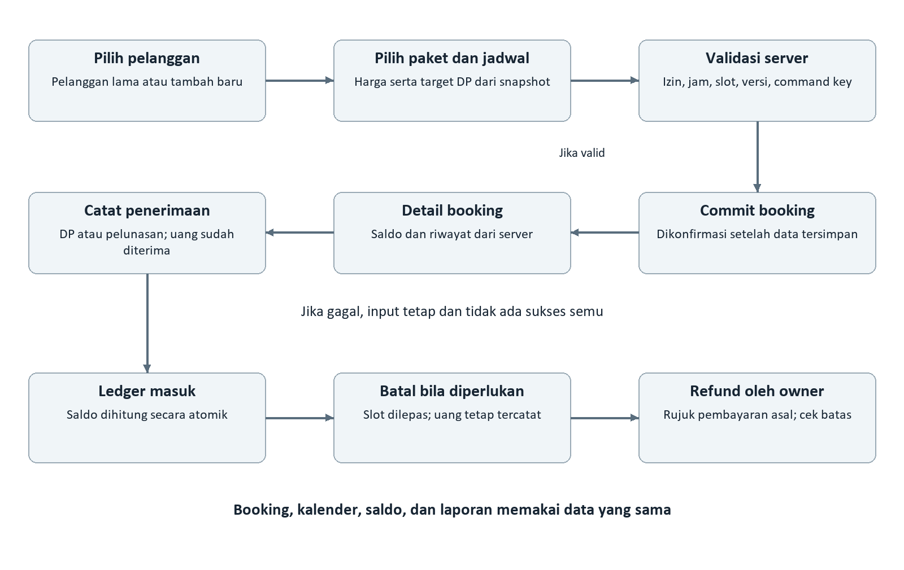
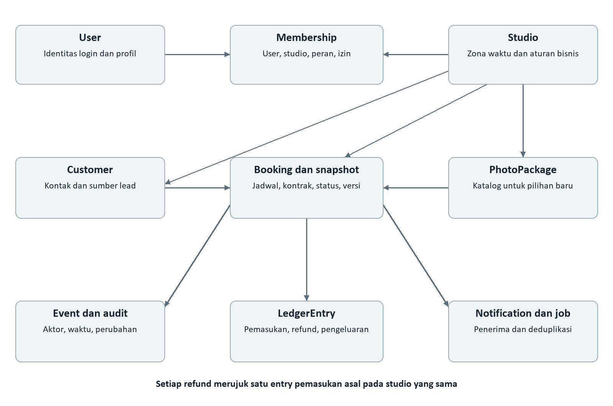

# Dokumen Proyek LensFlow

Kebutuhan produk dan spesifikasi fungsional

Versi dokumen 1.1 | Produk v1.0 | 16 Oktober 2026

Dokumen ini menetapkan perilaku aplikasi operasional studio foto LensFlow untuk pemilik dan staf. Cakupannya menghubungkan kebutuhan produk, use case, aturan bisnis, model data, kontrak layanan, pengujian, dan rencana rilis sehingga tim produk, desain, pengembang, dan QA dapat menggunakan acuan yang sama.

Target produk adalah aplikasi mobile berbahasa Indonesia untuk satu cabang studio, menggunakan React Native dan Expo. Booking, kalender, pelanggan, transaksi kas, dan laporan harus memakai sumber data yang sama. Keberhasilan rilis ditentukan oleh konsistensi jadwal dan uang, selain kesesuaian antarmuka.

## 1 Pengendalian dokumen dan referensi

| Atribut | Nilai |
| --- | --- |
| Nama proyek | LensFlow |
| Jenis dokumen | PRD dan spesifikasi proyek terpadu |
| Status | Usulan baseline untuk review pemilik produk |
| Pembaca | Pemilik produk, desainer, pengembang mobile, backend, QA, operasional studio |
| Target platform | Android dan iOS, orientasi portrait |
| Acuan viewport | Sekitar 390 × 900 pada brief; uji pada ukuran perangkat nyata |
| Bahasa dan mata uang | Indonesia dan Rupiah Indonesia |
| Lingkup organisasi | Satu studio dan satu cabang dengan owner serta staf |
| Penanggung jawab persetujuan | Pemilik produk dan pemilik studio, nama ditetapkan saat kickoff |

### 1.1 Referensi dan status kebutuhan

**R1 — Referensi desain.** [Untitled LensFlow di Figma](https://www.figma.com/design/rmUo33f23a8KDezy8Touuu/Untitled?node-id=0-1). Referensi halaman adalah node 0:1. Pemetaan node untuk masing-masing layar menjadi bagian review desain sebelum implementasi UI.

**R2 — Brief produk.** Lampiran pengguna dengan pembuka “PRD ini disusun dari file Untitled — LensFlow (Page 1, ~46 layar). Target implementasi: React Native + Expo.” Lampiran ini memuat inventaris layar, alur, fungsi, contoh data, dan beberapa ketidakpastian label.

Dokumen memakai tiga penanda. **B** berarti kebutuhan dinyatakan dalam brief R2. **U** berarti usulan detail operasional atau teknis untuk membuat kebutuhan dapat diimplementasikan dan diuji. **K** berarti keputusan produk masih terbuka dan dicatat pada bagian 20. Penanda B menunjukkan asal kebutuhan; penanda tersebut bukan persetujuan final atas copy atau rincian visual Figma.

Inventaris pada bagian 6 memecah penyebutan di brief menjadi **50 entri layar dan state**, termasuk UI showcase. Jumlah ini adalah cara pencatatan dokumen, bukan klaim jumlah frame Figma yang sudah dipastikan. State loading, modal, dan variasi tab dapat digabung dalam satu frame atau dipisah saat pemetaan desain.

### 1.2 Tata kelola perubahan

Versi 1.1 memperluas brief menjadi kebutuhan yang dapat ditelusuri. Setiap perubahan berikutnya mencatat tanggal, alasan, ID requirement, dampak terhadap data atau API, dan persetujuan pemilik produk. Perubahan harga, aturan refund, hak akses, atau definisi laporan harus memperbarui acceptance test sebelum kode dirilis.

Persetujuan baseline membutuhkan pemilik produk untuk menetapkan keputusan K yang memengaruhi perhitungan, akses, dan kapasitas kalender. Desainer memvalidasi pemetaan layar. Tech lead memvalidasi model transaksi dan integrasi. QA memvalidasi bahwa setiap requirement wajib memiliki bukti uji.

## 2 Ringkasan produk dan tujuan

### 2.1 Masalah yang ditangani

Studio kecil sering mencatat booking melalui chat dan spreadsheet yang terpisah dari kalender serta catatan pembayaran. Akibatnya staf dapat menjual slot yang sama, melewatkan sisa pelunasan, atau menghitung laporan dari angka yang berbeda. Masalah ini merupakan konteks produk dari brief, belum merupakan hasil riset kuantitatif.

LensFlow menyatukan alur pelanggan, pemilihan paket, pemesanan jadwal, pencatatan DP dan pelunasan, pembatalan, refund, pengeluaran, serta laporan kas. Owner dapat mengatur bisnis dan akses staf. Pelanggan hanya menjadi data CRM; pelanggan tidak memiliki akun aplikasi.

### 2.2 Sasaran dan indikator keberhasilan

Angka pada tabel adalah **usulan target pilot**, bukan angka performa yang sudah dicapai. Pengukuran dimulai setelah studio memiliki data penggunaan awal. Log operasional tidak boleh merekam nama atau nomor telepon pelanggan sebagai atribut analitik.

| ID | Sasaran | Ukuran dan target usulan | Cara mengukur |
| --- | --- | --- | --- |
| G01 | Mencegah bentrok | 0 booking aktif saling overlap pada kapasitas tunggal | Audit interval booking setelah setiap perubahan jadwal |
| G02 | Mempercepat pencatatan | Median membuat booking pelanggan lama ≤ 2 menit | Waktu dari form dibuka sampai server mengonfirmasi sukses |
| G03 | Menjaga angka kas | Selisih ledger dan laporan Rp 0 untuk periode uji | Rekonsiliasi pemasukan, refund, dan pengeluaran |
| G04 | Mengurangi data tercecer | 100% booking memiliki pelanggan, paket snapshot, jadwal, dan pencatat | Pemeriksaan integritas data |
| G05 | Mendukung operasional | ≥ 95% sesi pilot dicatat sebelum sesi dimulai | Perbandingan jadwal operasional dengan booking LensFlow |
| G06 | Memudahkan penggunaan | ≥ 90% skenario tugas inti selesai tanpa bantuan | UAT dengan owner dan minimal satu staf |

### 2.3 Nilai produk menurut pengguna

Owner membutuhkan gambaran jadwal dan kas yang dapat dipercaya serta kontrol atas staf. Staf membutuhkan pencatatan yang cepat, status yang jelas, dan pemulihan ketika jaringan gagal. Pelanggan menerima informasi melalui komunikasi studio, misalnya telepon atau WhatsApp yang dibuka dari aplikasi; keberhasilan komunikasi tersebut tidak dicatat sebagai pembayaran atau konfirmasi otomatis.

## 3 Pengguna dan hak akses

### 3.1 Aktor dan batas sistem

| Aktor | Kebutuhan utama | Hubungan dengan sistem |
| --- | --- | --- |
| Owner | Mengendalikan operasi, keuangan, dan konfigurasi studio | Akun internal dengan seluruh kewenangan studio |
| Staf | Menangani booking dan pelanggan sesuai tugas | Akun internal yang diundang owner |
| Pelanggan | Mendapatkan layanan foto dan komunikasi studio | Entitas CRM, tanpa login |
| Layanan autentikasi | Memvalidasi identitas dan reset password | Integrasi server |
| Layanan email dan push | Mengirim undangan, reset, dan pengingat | Aktor pendukung eksternal |
| Aplikasi telepon dan WhatsApp | Membuka kontak yang dipilih pengguna | Deep link pada perangkat |

### 3.2 Matriks kewenangan usulan

Brief menyebut empat toggle staf tetapi labelnya belum pasti. Untuk review, dokumen memisahkan **operasional booking**, **kalender dan CRM**, **pembayaran**, serta **laporan**. Pengaturan bisnis, paket, staf, refund, dan pengeluaran tetap owner pada baseline usulan. Pembagian ini harus diselaraskan dengan copy desain melalui K01; jangan mengimplementasikan label perkiraan sebagai fakta desain.

| Aksi | Owner | Staf dengan izin terkait | Staf tanpa izin |
| --- | --- | --- | --- |
| Melihat beranda | Ya | Data sesuai izin | Kartu terbatas, tanpa bocoran nominal |
| Membaca booking dan kalender | Ya | Booking atau kalender dan CRM | Ditolak |
| Membuat, mengubah, menjadwal ulang, membatalkan booking | Ya | Operasional booking | Ditolak |
| Menandai sesi selesai | Ya | Operasional booking | Ditolak |
| Membaca dan mengubah pelanggan | Ya | Kalender dan CRM | Ditolak |
| Membaca paket aktif pada form | Ya | Operasional booking | Ditolak bila tidak ada akses booking |
| Mengelola paket | Ya | Tidak | Ditolak |
| Mencatat DP dan pelunasan | Ya | Pembayaran, dengan akses minimum booking terkait | Ditolak |
| Melihat nominal dan daftar transaksi | Ya | Pembayaran | Ditolak |
| Melihat laporan dan rincian | Ya | Laporan | Ditolak |
| Mencatat pengeluaran dan refund | Ya | Tidak | Ditolak |
| Mengatur bisnis, staf, dan kewenangan | Ya | Tidak | Ditolak |
| Mengubah profil dan preferensi diri | Ya | Ya | Berlaku untuk profil sendiri |

Izin pembayaran mensyaratkan akses baca booking yang cukup untuk memilih transaksi, tanpa otomatis memberi izin mengubah jadwal. Izin operasional tidak memberi izin melihat arus kas studio. Kebijakan penyamaran nominal booking untuk staf tanpa izin pembayaran masih perlu keputusan K01.

Server harus menegakkan izin pada setiap baca dan tulis. Menyembunyikan menu tidak cukup. Seluruh data juga dibatasi studio_id. Penonaktifan keanggotaan staf mencabut akses server segera dan mengakhiri sesi saat aplikasi menyinkronkan status akun. Satu owner tidak dapat dihapus atau diturunkan menjadi staf melalui alur v1.

## 4 Cakupan dan prioritas rilis

### 4.1 Cakupan target produk v1

Seluruh modul dalam brief menjadi cakupan target: autentikasi lengkap, beranda, booking, kalender hari dan minggu dan bulan, CRM, paket, pemasukan, pengeluaran, refund, laporan dan rinciannya, notifikasi, profil, pengaturan bisnis, pengelolaan staf, bantuan, serta semua state loading, validasi, empty, dan error yang disebutkan.

**P0** adalah syarat pilot yang aman: autentikasi, isolasi studio, otorisasi, booking, bentrok jadwal, CRM minimum, paket, pembayaran yang konsisten, penyimpanan yang tahan pengulangan, dan pemulihan kegagalan. **P1** melengkapi seluruh target desain sebelum rilis v1 publik atau produksi penuh. **P2** adalah pengembangan setelah target v1 dan tidak dimasukkan diam-diam ke estimasi v1.

| Area | Prioritas | Hasil yang harus tersedia |
| --- | --- | --- |
| Akses akun dan izin | P0 | Login, reset, logout, undangan minimum, pembatasan server |
| Operasional inti | P0 | Booking, pelanggan, paket aktif, kalender hari dan minggu, ubah jadwal, batal |
| Integritas kas | P0 | DP, pelunasan, validasi, ledger, idempotensi, ringkasan saldo |
| Pelengkap kalender dan CRM | P1 | Kalender bulan, lead source, statistik riwayat, kontak |
| Keuangan lengkap | P1 | Pengeluaran, refund, laporan, rincian dan rekonsiliasi |
| Pengaturan dan komunikasi | P1 | Profil, bisnis, staf lengkap, inbox, push, FAQ, tentang |
| Kualitas pengalaman | P0 dan P1 | State kegagalan dan aksesibilitas pada fitur yang dirilis |

Membagi pembangunan menjadi gelombang tidak mengizinkan validasi pembayaran, pengecekan bentrok, atau otorisasi ditunda setelah fitur terkait dipakai oleh studio. UI showcase adalah referensi visual dan bukan menu produk.

### 4.2 Di luar cakupan

Portal booking mandiri pelanggan, multi-cabang, multi-ruang atau multi-fotografer, galeri hasil foto, penjualan publik paket, invoice PDF otomatis, payment gateway, webhook bank atau QRIS, WhatsApp API otomatis, pajak dan akuntansi akrual, fee reschedule, perhitungan overtime, tablet khusus, serta dark mode tidak termasuk target v1. Metode “Transfer” dan “QRIS” hanya label pencatatan pembayaran yang diverifikasi staf atau owner.

### 4.3 Ketergantungan awal

Tim memerlukan keputusan kapasitas tunggal, pemetaan izin, harga final booking, refund, dan definisi laporan. Tim juga memerlukan proyek backend, identitas aplikasi, domain deep link, kredensial layanan email, konfigurasi push, aset desain yang dapat diekspor, serta lingkungan staging. Akun pertama dibuat melalui provisioning owner yang terkontrol; alur pendaftaran publik tidak ada pada baseline.

## 5 Struktur navigasi dan alur pengguna

### 5.1 Navigasi aplikasi

Tab utama mengikuti brief: **Beranda, Booking, Kalender, Pelanggan, Lainnya**. Lainnya menjadi pintu ke paket, pembayaran, laporan, profil, bisnis, staf, bantuan, dan tentang sesuai izin. Beranda menyediakan shortcut dan ikon notifikasi. Halaman detail dan form dibuka sebagai stack di atas tab, dengan kembali ke konteks asal tanpa kehilangan filter.

Alur akun: Splash → pemeriksaan sesi → Beranda atau Login. Login → Lupa password → Email terkirim → tautan → Kata sandi baru → Reset berhasil → Login. Tautan yang tidak valid atau kedaluwarsa menuju state khusus dengan aksi meminta ulang.

Alur booking: Beranda atau Daftar atau Kalender → Booking baru → pilih atau tambah pelanggan → pilih paket → pilih jadwal → simpan → Detail booking. Detail booking menyediakan ubah, ubah jadwal, terima pembayaran, batalkan, dan refund sesuai kondisi serta izin.

Alur pelanggan: Daftar pelanggan → Detail pelanggan → edit, telepon, WhatsApp, riwayat, atau buat booking dengan pelanggan terisi. Ketika pelanggan baru dibuat dari form booking, sistem kembali ke draft booking dan memilih ID pelanggan baru. Kegagalan membuat booking tidak menghapus pelanggan yang sudah berhasil dibuat.

### 5.2 Diagram proses inti

Gambar 1. Pemeriksaan jadwal dilakukan server saat penyimpanan. Pencatatan uang dilakukan setelah booking tersedia; ringkasan DP pada form booking adalah target nominal dan tidak otomatis menjadi kas masuk. Bila desain mengharuskan DP awal dicatat saat simpan, transaksi booking dan pembayaran harus disimpan secara atomik sesuai K04.

### 5.3 Perilaku kembali dan deep link

Form yang berubah meminta pilihan lanjut mengedit atau buang perubahan saat pengguna kembali. Setelah sukses, tombol kembali tidak mengirim ulang transaksi. Deep link reset dan undangan harus memvalidasi token di server; tautan notifikasi memerlukan login lalu pemeriksaan izin terhadap booking. ID yang tidak ada atau berada di studio lain menampilkan pesan tidak tersedia tanpa membeberkan keberadaan data studio lain.

## 6 Inventaris layar dan state

Kode S adalah ID dokumentasi, bukan node Figma. Semua entri berikut berasal dari penyebutan di brief R2. Kolom tujuan menentukan perilaku yang harus dipetakan saat review desain. Tab, modal, dan state dapat memakai komponen yang sama dalam implementasi.

| ID | Layar atau state | Tujuan dan cakupan |
| --- | --- | --- |
| S01 | Splash | Memeriksa sesi dan keanggotaan studio |
| S02 | Login | Email dan password akun internal |
| S03 | Dashboard atau Beranda | Jadwal dan ringkasan sesuai izin |
| S04 | Daftar booking | Cari, filter, buka detail, tambah |
| S05 | Form booking baru | Pelanggan, paket, jadwal, lokasi, harga |
| S06 | Detail booking | Status sesi, saldo, kontak, aktivitas, aksi |
| S07 | Kalender minggu | Jadwal per minggu dan navigasi tanggal |
| S08 | Pelanggan | Daftar, pencarian, jumlah booking |
| S09 | Paket foto | Daftar paket dan status aktif |
| S10 | Pembayaran pemasukan | Daftar DP dan pelunasan |
| S11 | Laporan | Ringkasan periode dan grafik |
| S12 | Profil | Informasi akun dan preferensi |
| S13 | UI showcase | Referensi token dan komponen, bukan route pengguna |
| S14 | Lupa password | Meminta tautan reset |
| S15 | Email reset terkirim | Instruksi, kirim ulang, kembali |
| S16 | Kata sandi baru | Mengganti password melalui token |
| S17 | Reset berhasil | Konfirmasi dan menuju login |
| S18 | Tautan kedaluwarsa | Pemulihan reset token |
| S19 | Login gagal | Pesan autentikasi tanpa membocorkan akun |
| S20 | Form tambah pelanggan | Identitas, kontak, catatan, sumber lead |
| S21 | Detail pelanggan | Kontak, riwayat, buat booking |
| S22 | Edit pelanggan | Memperbarui informasi CRM |
| S23 | Form tambah paket | Harga, durasi, edit foto, lokasi, aktif |
| S24 | Edit paket | Perubahan katalog untuk booking berikutnya |
| S25 | Kalender hari | Timeline pada tanggal terpilih |
| S26 | Kalender bulan | Penanda hari dengan booking |
| S27 | Pembayaran pengeluaran | Daftar arus kas keluar |
| S28 | Catat pengeluaran | Kategori, nominal, metode, tanggal |
| S29 | Terima pembayaran | Jenis, nominal, metode, tanggal |
| S30 | Ubah jadwal | Jadwal baru dan validasi |
| S31 | Jadwal bentrok | Konflik dan kembali memilih waktu |
| S32 | Notifikasi | Inbox dan navigasi ke konteks |
| S33 | Edit profil | Identitas akun sendiri |
| S34 | Pengaturan bisnis | Studio, jam, DP, pengingat |
| S35 | Bantuan atau FAQ | Panduan dan kontak dukungan |
| S36 | Tentang | Versi produk, studio, lisensi |
| S37 | Konfirmasi batal | Konfirmasi pembatalan booking |
| S38 | Konfirmasi keluar | Konfirmasi logout |
| S39 | Kelola staf | Owner terkunci, staf, status |
| S40 | Undang staf | Email, peran, empat izin |
| S41 | Rincian laporan | Komponen kas dan metodologi |
| S42 | Refund | Pilih pembayaran asal dan nominal |
| S43 | Detail setelah refund | Riwayat refund dan saldo terbaru |
| S44 | Validasi pembayaran | Nominal atau jenis pembayaran tidak sah |
| S45 | Menyimpan booking | Proses simpan, cegah ketukan ganda |
| S46 | Booking tersimpan | Konfirmasi setelah commit server |
| S47 | Booking kosong | Belum ada data atau hasil filter kosong |
| S48 | Pelanggan kosong | Belum ada pelanggan atau hasil pencarian kosong |
| S49 | Gagal memuat booking | Retry tanpa menganggap data kosong |
| S50 | Gagal menyimpan pelanggan | Pertahankan input dan tawarkan retry |

Beberapa perilaku perlu desain tambahan yang terbatas: daftar menu Lainnya, form ubah booking yang bukan reschedule, aksi sesi selesai, penerimaan undangan, akses ditolak, filter terbuka, picker tanggal dan jam, penolakan izin push, serta input alasan refund. Perilaku tersebut adalah kebutuhan turunan U dan harus dipetakan ke komponen yang ada atau memperoleh desain sebelum implementasi.

## 7 Kebutuhan fungsional

Setiap FR harus ditegakkan melalui UI dan layanan server bila terkait data atau kewenangan. Prioritas dan sumber disertakan agar kebutuhan eksplisit dapat dibedakan dari usulan rincian. Kriteria skenario lintas fitur tersedia di bagian 17.

### 7.1 Akun dan sesi

| ID | Kebutuhan dan hasil yang dapat diamati | Prioritas | Sumber |
| --- | --- | --- | --- |
| FR01 | Splash memeriksa sesi dan keanggotaan aktif, lalu membuka tujuan yang sah | P0 | B dan U |
| FR02 | Login dengan email dan password; gagal menampilkan pesan jelas dan dapat dicoba ulang | P0 | B |
| FR03 | Reset password mengirim tautan sekali pakai dengan masa berlaku 30 menit | P0 | B |
| FR04 | Token reset tidak sah atau kedaluwarsa ditolak; reset sukses menuju login | P0 | B |
| FR05 | Logout memerlukan konfirmasi, menghapus kredensial dan cache sensitif lokal | P0 | B dan U |
| FR06 | Keanggotaan dan hak akses diperiksa server pada setiap operasi studio | P0 | U |

Pesan permintaan reset memakai respons yang sama untuk email terdaftar dan tidak terdaftar. Pengiriman ulang dibatasi agar tidak memicu spam. Kebijakan password, masa sesi, dan cooldown harus konsisten dengan konfigurasi layanan autentikasi; usulan angka ada pada NFR dan K13.

### 7.2 Beranda dan booking

| ID | Kebutuhan dan hasil yang dapat diamati | Prioritas | Sumber |
| --- | --- | --- | --- |
| FR07 | Beranda menampilkan sapaan, jumlah sesi hari ini, jadwal terdekat, dan kas masuk sesuai izin | P0 | B dan U |
| FR08 | Daftar booking mendukung pencarian nama atau paket atau tanggal serta filter status dan paket | P0 | B |
| FR09 | Booking baru memilih pelanggan lama atau membuat pelanggan baru lalu kembali ke draft | P0 | B dan U |
| FR10 | Pemilihan paket aktif mengisi harga, durasi, dan lokasi default serta target DP | P0 | B |
| FR11 | Simpan booking memvalidasi jam, bentrok, pelanggan, paket, dan izin di server | P0 | B dan U |
| FR12 | Penyimpanan menampilkan loading dan sukses hanya setelah server commit; retry tidak menggandakan data | P0 | B dan U |
| FR13 | Detail menggabungkan kontak, jadwal, status sesi, tagihan, saldo, catatan, dan aktivitas | P0 | B |
| FR14 | Perubahan data booking mempertahankan identitas dan riwayat; perubahan finansial dibatasi | P0 | B dan U |
| FR15 | Reschedule memakai validasi slot yang sama dan meninggalkan jadwal lama jika gagal | P0 | B dan U |
| FR16 | Pembatalan membuka slot tanpa refund otomatis dan tanpa menghapus transaksi | P0 | B |
| FR17 | Pengguna berizin menandai sesi selesai dan mencatat aktor serta waktunya | P1 | U |
| FR18 | Status pembayaran dihitung dari ledger; pengguna tidak dapat mengubah badge secara manual | P0 | B dan U |

Pencarian tanggal harus menerima bentuk yang jelas seperti 18/10/2026 melalui parser atau filter tanggal; substring bebas tidak boleh menghasilkan interpretasi tanggal yang berubah-ubah. Filter diingat selama pengguna kembali dari detail dalam sesi yang sama.

### 7.3 Kalender dan pelanggan

| ID | Kebutuhan dan hasil yang dapat diamati | Prioritas | Sumber |
| --- | --- | --- | --- |
| FR19 | Kalender hari, minggu, dan bulan membaca booking yang sama dengan daftar | P0 hari dan minggu, P1 bulan | B |
| FR20 | Pengguna menggeser periode, memilih tanggal, membuka detail, atau menambah booking dari kalender | P0 | B |
| FR21 | Booking dibatalkan dikeluarkan dari kapasitas; riwayatnya tetap tersedia | P0 | B dan U |
| FR22 | Pelanggan dapat dicari berdasarkan nama atau nomor yang sudah dinormalisasi | P0 | B dan U |
| FR23 | Tambah dan edit pelanggan memvalidasi nama dan kontak serta menjaga input saat gagal | P0 | B dan U |
| FR24 | Detail pelanggan menampilkan riwayat, jumlah booking, awal relasi, dan CTA booking | P1 | B |
| FR25 | Tombol telepon dan WhatsApp membuka aplikasi eksternal dengan nomor yang sah | P1 | B |
| FR26 | Nomor pelanggan yang sama memunculkan peringatan duplikat sebelum penyimpanan | P1 | U |

### 7.4 Paket dan transaksi

| ID | Kebutuhan dan hasil yang dapat diamati | Prioritas | Sumber |
| --- | --- | --- | --- |
| FR27 | Owner membuat dan mengubah paket dengan harga, durasi, jumlah edit foto, lokasi, dan aktif | P0 | B dan U |
| FR28 | Paket nonaktif tidak dapat dipilih untuk booking baru; snapshot booking lama tetap utuh | P0 | B dan U |
| FR29 | Daftar pemasukan dan pengeluaran dapat difilter menurut periode dan metode | P1 | B |
| FR30 | Terima pembayaran mengikat DP atau pelunasan ke booking dan menghitung ulang saldo | P0 | B |
| FR31 | Server menolak nilai nol, negatif, melebihi sisa, atau jenis yang tidak sesuai | P0 | B dan U |
| FR32 | Pengeluaran mencatat kategori, uraian, nominal, metode, tanggal, dan owner pencatat | P1 | B |
| FR33 | Refund owner mereferensikan pembayaran asal dan tidak melampaui nominal yang tersedia | P1 | B dan U |
| FR34 | Transaksi bersifat append only; koreksi menggunakan reversal yang tertelusur | P0 dan P1 | U |
| FR35 | Setiap perintah uang mendukung idempotency key dan pemeriksaan versi terbaru | P0 | U |

### 7.5 Laporan dan notifikasi

| ID | Kebutuhan dan hasil yang dapat diamati | Prioritas | Sumber |
| --- | --- | --- | --- |
| FR36 | Laporan menampilkan pemasukan, refund, kas masuk bersih, pengeluaran, dan hasil kas periode | P1 | B dan U |
| FR37 | Rincian dan grafik memakai tanggal transaksi serta formula yang sama dengan ringkasan | P1 | B dan U |
| FR38 | Jumlah booking dan rata-rata per booking diberi definisi periode yang eksplisit | P1 | B dan U |
| FR39 | Tren terhadap periode pembanding menangani nilai nol dan periode belum selesai | P1 | B dan U |
| FR40 | Inbox menampilkan pengingat pelunasan, ringkasan jadwal, dan pembayaran masuk | P1 | B |
| FR41 | Push meminta izin OS dan mengikuti preferensi pengguna serta bisnis | P1 | B dan U |
| FR42 | Pengingat tidak terkirim ganda dan dihentikan ketika lunas, batal, atau tidak lagi berizin | P1 | U |

### 7.6 Pengaturan dan kualitas pengalaman

| ID | Kebutuhan dan hasil yang dapat diamati | Prioritas | Sumber |
| --- | --- | --- | --- |
| FR43 | Profil menampilkan dan mengubah nama, nomor owner atau staf, jabatan, serta avatar opsional | P1 | B |
| FR44 | Owner mengatur studio, alamat, jam, DP default, zona waktu, dan pengingat | P0 minimum, P1 lengkap | B dan U |
| FR45 | Owner melihat daftar staf, mengundang, memperbarui izin, dan menonaktifkan keanggotaan | P0 minimum, P1 lengkap | B dan U |
| FR46 | Penerimaan undangan memverifikasi email dan token sebelum mengaktifkan keanggotaan | P0 | U |
| FR47 | FAQ dan Tentang menampilkan informasi dukungan, versi, serta studio terhubung | P1 | B |
| FR48 | Seluruh daftar dan form memiliki loading, empty, error, retry, serta state tanpa izin | P0 dan P1 | B dan U |
| FR49 | Draft lokal hanya membantu pemulihan input; booking dan uang memerlukan konfirmasi online | P0 | U |
| FR50 | Perubahan penting menyimpan audit aktor, waktu, objek, dan perubahan yang relevan | P0 | U |

## 8 Katalog use case

Use case berikut mendefinisikan perilaku sistem, bukan hanya urutan layar. Aktor staf selalu mensyaratkan izin terkait. Kegagalan jaringan setelah kirim harus diselesaikan dengan pemeriksaan hasil atau retry menggunakan identitas perintah yang sama.

### UC01 Masuk dan memulihkan sesi

**Tujuan dan aktor.** Owner atau staf masuk ke studio yang benar. Pemicu adalah aplikasi dibuka atau sesi habis. Prasyaratnya akun internal dan keanggotaan aktif.

**Alur utama.** 1) Aplikasi memeriksa token tersimpan. 2) Jika valid, server mengembalikan profil dan izin. 3) Jika perlu login, pengguna memasukkan email dan password. 4) Server mengautentikasi dan memeriksa membership. 5) Aplikasi membuka Beranda sesuai hak akses.

**Alternatif dan kegagalan.** Kredensial salah menampilkan S19. Keanggotaan dinonaktifkan menolak akses walau password benar. Jaringan gagal menampilkan retry dan tidak membuat sesi fiktif. Jika ada deep link tertunda, tujuan dibuka setelah pemeriksaan izin.

**Hasil dan acuan.** Sesi tersimpan aman; data studio lain tidak terlihat. FR01, FR02, FR06; S01, S02, S03, S19; AT01 dan AT02.

### UC02 Mereset password

**Tujuan dan aktor.** Owner atau staf memperoleh kembali akses. Pemicu adalah Lupa password. Pengguna tidak perlu memiliki sesi aktif.

**Alur utama.** 1) Pengguna mengisi email. 2) Server memberi respons generik dan, jika akun memenuhi syarat, mengirim tautan. 3) Pengguna membuka tautan dalam 30 menit. 4) Server memvalidasi token sekali pakai. 5) Pengguna mengisi password baru dan konfirmasi. 6) Password berubah dan aplikasi menampilkan berhasil lalu login.

**Alternatif dan kegagalan.** Tautan kedaluwarsa menuju S18. Token yang telah dipakai tidak dapat dipakai lagi. Password tidak sesuai kebijakan atau konfirmasi berbeda menampilkan error per field. Kirim ulang memakai cooldown dan membatalkan token lama sesuai konfigurasi yang dipilih.

**Hasil dan acuan.** Password berubah hanya setelah verifikasi token. Sesi lama dicabut sesuai kebijakan K13. FR03, FR04; S14 sampai S18; AT03.

### UC03 Membuat booking untuk pelanggan lama

**Tujuan dan aktor.** Owner atau staf operasional menjadwalkan sesi. Pemicu adalah Booking baru dari Beranda, daftar, pelanggan, atau kalender. Prasyaratnya pelanggan dan paket aktif tersedia.

**Alur utama.** 1) Pengguna memilih pelanggan. 2) Pengguna memilih paket; sistem mengisi snapshot harga dan durasi. 3) Pengguna memilih tanggal, jam, lokasi, dan catatan. 4) Sistem menampilkan total dan target DP. 5) Pengguna menyimpan. 6) Server memeriksa membership, input, jam, paket aktif, dan overlap dalam satu transaksi. 7) Server membuat kode booking unik. 8) UI menampilkan sukses dan detail.

**Alternatif dan kegagalan.** Paket nonaktif saat submit menghasilkan instruksi memilih ulang. Konflik jadwal membuka S31 dengan input tetap ada. Permintaan ganda mengembalikan booking yang sama. Bila respons hilang setelah commit, aplikasi mencari hasil perintah sebelum menawarkan membuat ulang.

**Hasil dan acuan.** Satu booking confirmed muncul di daftar dan kalender. Belum ada uang tercatat hanya karena target DP ditampilkan. FR09 sampai FR13, FR35; S05, S06, S31, S45, S46; AT04 sampai AT08.

### UC04 Menambah pelanggan dari form booking

**Tujuan dan aktor.** Owner atau staf yang memiliki izin CRM menambahkan pelanggan tanpa kehilangan draft. Pemicu adalah pilihan Pelanggan baru di S05.

**Alur utama.** 1) Aplikasi menyimpan draft booking sementara. 2) Form pelanggan meminta nama dan nomor WhatsApp. 3) Pengguna mengisi catatan dan lead source bila ada. 4) Server menormalisasi nomor dan memberi peringatan kemungkinan duplikat. 5) Setelah sukses, aplikasi kembali ke draft dan memilih pelanggan baru. 6) Pengguna melanjutkan UC03.

**Alternatif dan kegagalan.** Pengguna batal kembali ke draft tanpa pelanggan baru. Gagal simpan mempertahankan input pada S50. Staf tanpa izin membuat CRM dapat memilih pelanggan lama atau meminta owner membuat data. Pelanggan yang sudah tersimpan tidak dibuat lagi saat retry booking.

**Hasil dan acuan.** Satu pelanggan sah tersedia, terlepas dari kelanjutan booking. FR09, FR23, FR26, FR49; S05, S20, S50; AT09.

### UC05 Mencari dan membaca booking

**Tujuan dan aktor.** Owner atau staf menemukan booking yang tepat. Pemicu adalah tab Booking atau pencarian dari alur operasional.

**Alur utama.** 1) Sistem memuat halaman data awal. 2) Pengguna memasukkan nama, paket, atau tanggal yang dapat diparse. 3) Pengguna memilih filter status dan paket. 4) Sistem menerapkan filter gabungan pada server. 5) Pengguna membuka kartu dan memperoleh detail terbaru. 6) Kembali ke daftar mempertahankan filter serta posisi yang layak.

**Alternatif dan kegagalan.** Belum ada booking menampilkan CTA buat. Hasil filter nol menawarkan hapus filter. Kegagalan memuat menampilkan S49, bukan S47. Booking yang tidak tersedia memberi pesan aman dan jalan kembali.

**Hasil dan acuan.** Detail sesuai booking terpilih dan izin pengguna. FR08, FR13, FR48; S04, S06, S47, S49; AT10.

### UC06 Mengubah data booking

**Tujuan dan aktor.** Owner atau staf memperbarui detail yang diizinkan. Prasyaratnya booking belum dibatalkan dan versi data masih terbaru.

**Alur utama.** 1) Pengguna memilih Ubah. 2) Sistem memuat field yang boleh diubah. 3) Pengguna mengubah lokasi atau catatan; perubahan jadwal melalui UC07. 4) Server memvalidasi versi dan field. 5) Server menyimpan perubahan serta audit. 6) Detail menampilkan hasil baru.

**Alternatif dan kegagalan.** Versi usang meminta pengguna memuat ulang dan membandingkan perubahan. Mengubah paket sebelum pembayaran dapat memperbarui snapshot setelah konfirmasi. Setelah ada transaksi, perubahan harga atau paket diblokir pada baseline sampai K05 menetapkan mekanisme penyesuaian.

**Hasil dan acuan.** Booking lama tidak berubah karena edit katalog paket. FR14, FR28, FR50; S06 dan desain form turunan; AT11.

### UC07 Menjadwal ulang booking

**Tujuan dan aktor.** Owner atau staf memindahkan sesi tanpa menggandakan booking. Prasyaratnya status confirmed, atau hold jika kelak diaktifkan.

**Alur utama.** 1) Pengguna membuka Ubah jadwal. 2) Sistem menampilkan jadwal sekarang. 3) Pengguna memilih tanggal, jam, dan durasi yang diizinkan. 4) Server memvalidasi jam operasional serta overlap dengan mengecualikan booking itu sendiri. 5) Server memperbarui interval dan audit secara atomik. 6) Kalender lama dan baru diperbarui serta pengingat dijadwalkan ulang.

**Alternatif dan kegagalan.** Konflik menampilkan S31 dan tidak mengubah jadwal lama. Reschedule bersamaan oleh pengguna lain menghasilkan konflik versi. Booking batal atau selesai tidak dapat di-reschedule tanpa alur pemulihan khusus yang berada di luar baseline.

**Hasil dan acuan.** Identitas dan transaksi booking tetap sama. FR15, FR19, FR42; S30, S31; AT12 dan AT13.

### UC08 Membatalkan booking

**Tujuan dan aktor.** Owner atau staf operasional menghentikan sesi yang belum selesai. Pemicu adalah Batalkan pada detail.

**Alur utama.** 1) Sistem menampilkan konfirmasi dan penjelasan bahwa refund terpisah. 2) Pengguna memberi alasan sesuai kebijakan. 3) Server memvalidasi status dan versi. 4) Status menjadi cancelled dan slot dilepas. 5) Riwayat dan pembayaran dipertahankan. 6) Pengingat pelunasan dibatalkan.

**Alternatif dan kegagalan.** Pengguna menutup modal tanpa perubahan. Booking yang sudah cancelled memberi hasil konsisten tanpa membatalkan dua kali. Booking selesai menolak pembatalan biasa. Jika terdapat pembayaran, owner dapat melanjutkan UC17 sesuai kebijakan refund.

**Hasil dan acuan.** Pembatalan tidak membuat transaksi keluar. Sisa harga paket pada booking batal tidak otomatis menjadi piutang yang ditagih. FR16, FR21; S06, S37; AT14.

### UC09 Menandai sesi selesai

**Tujuan dan aktor.** Owner atau staf mencatat pekerjaan foto telah dilaksanakan. Prasyaratnya booking confirmed dan waktu mulai sudah tercapai pada baseline usulan.

**Alur utama.** 1) Pengguna memilih Selesaikan sesi melalui aksi detail yang perlu pemetaan desain. 2) Sistem meminta konfirmasi. 3) Server memvalidasi status dan kewenangan. 4) Status menjadi done dan audit mencatat aktor serta waktu. 5) Status pembayaran tetap dihitung sendiri.

**Alternatif dan kegagalan.** Booking batal ditolak. Sesi dengan pembayaran belum lunas dapat selesai, tetapi saldo masih ditampilkan dan dapat dilunasi. Mengembalikan done ke confirmed memerlukan kebijakan koreksi owner, belum aktif pada baseline.

**Hasil dan acuan.** Selesai tidak sama dengan lunas. FR17, FR18; S06 dan aksi turunan; AT15; K06.

### UC10 Menggunakan kalender

**Tujuan dan aktor.** Owner atau staf membaca kapasitas studio. Pemicu adalah tab Kalender.

**Alur utama.** 1) Sistem membuka periode aktif pada zona waktu studio. 2) Pengguna memilih Hari, Minggu, atau Bulan. 3) Sistem memuat booking pada rentang tersebut. 4) Pengguna berpindah periode dan memilih sesi. 5) Detail dibuka atau FAB membuka form dengan tanggal terpilih.

**Alternatif dan kegagalan.** Periode kosong menampilkan timeline atau kalender yang tetap dapat dinavigasi. Gagal sinkron menampilkan indikator data lama dan retry. Pergantian mode mempertahankan tanggal fokus. Booking cancelled tidak menghalangi slot baru.

**Hasil dan acuan.** Jumlah dan detail jadwal sama dengan daftar untuk rentang dan filter yang sama. FR19 sampai FR21; S07, S25, S26; AT16.

### UC11 Mengelola pelanggan

**Tujuan dan aktor.** Owner atau staf CRM memelihara data kontak. Pemicu adalah tambah, edit, pencarian, atau detail pelanggan.

**Alur utama.** 1) Pengguna mencari data yang ada. 2) Pengguna menambah atau mengedit nama, nomor, catatan, dan lead source. 3) Server memvalidasi dan menormalisasi nomor. 4) Sistem memberi peringatan jika nomor sama. 5) Pengguna menggunakan data lama atau menyimpan pelanggan berbeda setelah konfirmasi. 6) Detail dan booking terkait menampilkan data kontak terbaru.

**Alternatif dan kegagalan.** Gagal simpan mempertahankan input. Catatan terlalu panjang memberi error field. Tidak ada hapus permanen pelanggan ber-booking pada v1. Penggabungan pelanggan duplikat belum tersedia; kebijakan arsip perlu keputusan jika diminta.

**Hasil dan acuan.** Riwayat booking tidak hilang dan perubahan tercatat. FR22 sampai FR26, FR50; S08, S20 sampai S22, S48, S50; AT09 dan AT17.

### UC12 Menghubungi pelanggan

**Tujuan dan aktor.** Owner atau staf CRM membuka telepon atau WhatsApp. Prasyaratnya nomor valid dan pengguna berizin melihat kontak.

**Alur utama.** 1) Pengguna membuka detail pelanggan atau booking. 2) Pengguna menekan Telepon atau WhatsApp. 3) Aplikasi membentuk URI dari nomor terstandardisasi. 4) Sistem operasi membuka aplikasi terkait. 5) Pengguna melanjutkan komunikasi di aplikasi tersebut.

**Alternatif dan kegagalan.** Nomor kosong membuat aksi tidak aktif. Aplikasi eksternal tidak tersedia menampilkan pesan dan opsi salin nomor jika diizinkan. Membuka deep link tidak mengirim pesan otomatis dan tidak menandai pelanggan sudah dihubungi.

**Hasil dan acuan.** Tidak terjadi perubahan booking atau uang. FR25; S06, S21; AT18.

### UC13 Mengelola paket foto

**Tujuan dan aktor.** Owner mengatur katalog internal studio. Pemicu adalah tambah, edit, atau nonaktifkan dari daftar paket.

**Alur utama.** 1) Owner mengisi nama, harga IDR, durasi menit, jumlah foto edit, lokasi default, dan aktif. 2) Server memvalidasi angka. 3) Paket disimpan. 4) Paket aktif tersedia untuk booking baru. 5) Perubahan berikutnya hanya memengaruhi pemilihan baru.

**Alternatif dan kegagalan.** Staf tanpa izin ditolak server. Harga atau durasi tidak valid menampilkan error. Menonaktifkan paket tidak menghapus booking yang sudah memakainya. Hapus permanen paket yang pernah dipakai tidak tersedia.

**Hasil dan acuan.** Katalog berubah tanpa menulis ulang transaksi historis. FR27, FR28; S09, S23, S24; AT19.

### UC14 Mencatat DP

**Tujuan dan aktor.** Owner atau staf pembayaran mencatat uang yang benar-benar diterima. Prasyaratnya booking aktif atau selesai memiliki sisa tagihan dan bukti penerimaan telah diverifikasi secara operasional.

**Alur utama.** 1) Pengguna membuka Terima pembayaran. 2) Sistem mengambil sisa terbaru dan menyarankan DP default. 3) Pengguna memilih DP, nominal, metode, dan tanggal. 4) Server mengunci saldo terkait dan memvalidasi idempotency key. 5) Nominal DP harus lebih dari nol dan lebih kecil dari sisa. 6) Transaksi masuk diposting. 7) Detail memperbarui saldo dan aktivitas.

**Alternatif dan kegagalan.** Nominal sama dengan sisa diminta memakai jenis Pelunasan. Nominal melebihi sisa ditolak. Jaringan terputus setelah submit diperiksa melalui ID perintah yang sama. Label metode tidak menjalankan penagihan bank.

**Hasil dan acuan.** Kas masuk tercatat sekali dan saldo berkurang tepat. FR30, FR31, FR35; S29, S44; AT20 dan AT21.

### UC15 Mencatat pelunasan

**Tujuan dan aktor.** Owner atau staf pembayaran menutup sisa tagihan booking. Prasyaratnya sisa tagihan lebih dari nol dan booking tidak cancelled.

**Alur utama.** 1) Sistem menampilkan sisa terbaru. 2) Pengguna memilih Pelunasan dengan nominal sama dengan sisa, metode, serta tanggal. 3) Server memeriksa versi dan saldo dalam transaksi. 4) Kas masuk diposting. 5) Status bayar menjadi lunas. 6) Pengingat pelunasan yang belum dikirim dihentikan.

**Alternatif dan kegagalan.** Jika pembayaran lain telah masuk, server menolak saldo usang dan mengembalikan sisa terbaru. Pembayaran langsung seluruh harga diperbolehkan sebagai pelunasan pertama. Sisa nol menonaktifkan aksi bayar dan server tetap menolak perintah baru.

**Hasil dan acuan.** Total bersih dibayar sama dengan harga kontrak. FR18, FR30, FR31, FR35; S06, S29, S44; AT22.

### UC16 Mencatat pengeluaran studio

**Tujuan dan aktor.** Owner mencatat arus kas keluar operasional. Pemicu adalah Catat pengeluaran.

**Alur utama.** 1) Owner mengisi kategori, uraian, nominal, tanggal, dan metode. 2) Server memvalidasi nominal positif serta tanggal yang diizinkan. 3) Transaksi pengeluaran diposting dengan ID perintah. 4) Daftar pengeluaran dan laporan periode diperbarui.

**Alternatif dan kegagalan.** Staf ditolak. Kegagalan jaringan mempertahankan input dan retry tidak menggandakan transaksi. Refund pelanggan harus melalui UC17 agar tidak tercatat dua kali sebagai pengeluaran biasa.

**Hasil dan acuan.** Pengeluaran mengurangi hasil kas satu kali tanpa mengubah saldo booking. FR29, FR32, FR34, FR35; S27, S28; AT23.

### UC17 Memproses refund booking

**Tujuan dan aktor.** Owner mencatat uang yang sudah dikembalikan kepada pelanggan. Baseline usulan membatasi refund pada booking cancelled; perluasan refund sesi aktif atau selesai membutuhkan K07.

**Alur utama.** 1) Owner membuka Refund dari detail. 2) Sistem menampilkan pembayaran asal serta jumlah yang belum direfund. 3) Owner memilih transaksi, nominal, metode, tanggal, dan alasan. 4) Server memverifikasi status, saldo refundable per transaksi, dan ID perintah dalam transaksi atomik. 5) Ledger refund diposting dengan referensi asal. 6) Detail menampilkan refund parsial atau penuh dan laporan mengurangi kas masuk bersih.

**Alternatif dan kegagalan.** Nominal melebihi sisa refundable ditolak. Dua refund serentak tidak dapat mengembalikan lebih dari penerimaan asal. Pembatalan saja tidak membuktikan uang sudah dikembalikan. Jika transfer pengembalian gagal di luar aplikasi, owner tidak memposting refund sampai pengembalian benar-benar dilakukan.

**Hasil dan acuan.** Tidak ada pengeluaran operasional duplikat untuk refund yang sama. FR33 sampai FR35, FR36; S42, S43; AT24 dan AT25.

### UC18 Membaca daftar transaksi

**Tujuan dan aktor.** Owner atau staf pembayaran memeriksa kas. Pemicu adalah menu Pembayaran.

**Alur utama.** 1) Pengguna memilih Pemasukan atau Pengeluaran. 2) Pengguna memilih bulan dan metode. 3) Server memuat transaksi sesuai tanggal efektif dan izin. 4) UI menampilkan nominal, kategori atau pelanggan, metode, serta jenis. 5) Transaksi terkait booking membuka detail yang relevan.

**Alternatif dan kegagalan.** Daftar kosong dibedakan dari gagal memuat. Refund ditandai jelas sebagai kas keluar terkait booking dan dapat ditelusuri melalui detail; lokasi tab tampilannya diputuskan di K08. Filter tidak mengubah ledger atau hasil periode lain.

**Hasil dan acuan.** Jumlah transaksi cocok dengan rincian laporan untuk filter yang setara. FR29, FR34; S10, S27, S43; AT26.

### UC19 Membaca dan merekonsiliasi laporan

**Tujuan dan aktor.** Owner atau staf laporan memahami kas periode. Pemicu adalah menu Laporan.

**Alur utama.** 1) Pengguna memilih periode. 2) Server menghitung pemasukan bruto, refund, penerimaan bersih, pengeluaran, dan hasil kas. 3) UI menampilkan jumlah booking dan definisi rata-rata. 4) Pengguna membuka rincian untuk memeriksa komponen. 5) Grafik dan perbandingan memakai formula yang sama.

**Alternatif dan kegagalan.** Periode kosong menampilkan nol dengan metodologi yang tetap tersedia. Nilai pembanding nol menampilkan “Belum dapat dibandingkan”. Transaksi backdate mengubah laporan periode efektif dan audit menyimpan waktu pencatatan sebenarnya.

**Hasil dan acuan.** Ringkasan, grafik, dan ledger dapat direkonsiliasi tepat. FR36 sampai FR39; S11, S41; AT27 sampai AT29.

### UC20 Menerima dan membuka notifikasi

**Tujuan dan aktor.** Owner atau staf yang berhak menerima pengingat yang relevan. Pemicu adalah event transaksi atau scheduler.

**Alur utama.** 1) Server menentukan event, penerima, waktu studio, dan izin. 2) Server memeriksa kondisi terbaru dan kunci deduplikasi. 3) Inbox dibuat. 4) Jika preferensi serta izin OS mengizinkan, push dikirim. 5) Pengguna membuka notifikasi, login bila perlu, lalu menuju detail yang masih dapat diakses. 6) read_at diperbarui.

**Alternatif dan kegagalan.** Push ditolak OS tetap memungkinkan inbox. Booking sudah lunas atau batal membatalkan pengingat tertunda. Akses staf yang dicabut membuat detail ditolak. Retry provider tidak membuat inbox ganda. Isi lock screen tidak menyertakan nomor pelanggan.

**Hasil dan acuan.** Notifikasi mengikuti status terbaru dan kewenangan. FR40 sampai FR42; S32, S12, S34; AT30.

### UC21 Mengatur profil dan bisnis

**Tujuan dan aktor.** Pengguna mengatur profil sendiri; owner mengatur bisnis. Pemicu adalah Edit profil atau Pengaturan bisnis.

**Alur utama.** 1) Pengguna membuka form yang berhak diakses. 2) Pengguna mengubah nilai. 3) Server memvalidasi nama, nomor, jam, persentase, dan pengingat. 4) Perubahan disimpan serta diaudit. 5) Nilai default baru berlaku untuk booking berikutnya dan scheduler disesuaikan bila perlu.

**Alternatif dan kegagalan.** Perubahan jam yang berbenturan dengan booking lama memunculkan daftar dampak dan memerlukan penyelesaian, bukan memindah jadwal diam-diam. Email login ditampilkan read only pada baseline; perubahan email perlu verifikasi khusus. Zona waktu tidak bebas diubah setelah ada transaksi tanpa review migrasi.

**Hasil dan acuan.** Profil pelanggan tidak tercampur profil akun. FR43, FR44; S12, S33, S34; AT31.

### UC22 Mengundang dan mengelola staf

**Tujuan dan aktor.** Owner memberi akses sesuai tugas. Pemicu adalah Undang staf atau ubah status staf.

**Alur utama.** 1) Owner memasukkan email dan empat izin hasil keputusan K01. 2) Server menyimpan undangan pending dan mengirim token. 3) Penerima membuktikan kepemilikan email melalui alur undangan. 4) Pengguna membuat password atau masuk ke akun yang sesuai. 5) Membership aktif dibuat. 6) Owner dapat mengubah izin atau menonaktifkan membership; audit disimpan.

**Alternatif dan kegagalan.** Undangan duplikat menawarkan kirim ulang terkontrol. Undangan kedaluwarsa atau dicabut tidak dapat diterima. Pemilik tidak bisa menghapus owner tunggal. Staf tidak dapat menaikkan izin dirinya melalui API. Pengiriman email gagal tidak ditampilkan sebagai undangan sudah diterima.

**Hasil dan acuan.** Akses terikat pada email, studio, dan izin terbaru. FR06, FR45, FR46, FR50; S39, S40 dan alur penerimaan turunan; AT02 dan AT32.

### UC23 Menggunakan bantuan dan informasi aplikasi

**Tujuan dan aktor.** Owner atau staf menemukan panduan dan konteks instalasi. Pemicu adalah FAQ atau Tentang.

**Alur utama.** 1) Pengguna membaca topik bantuan. 2) UI menampilkan kanal dukungan yang dikonfirmasi serta jam layanan. 3) Tentang menampilkan versi aplikasi, studio aktif, dan cakupan lisensi satu cabang. 4) Tombol email membuka mailer jika tersedia.

**Alternatif dan kegagalan.** Alamat support@lensflow.app dan Senin sampai Jumat 09.00–17.00 adalah copy contoh brief sampai dikonfirmasi K14. Tidak ada pengiriman email otomatis. Tidak ada CTA portal pelanggan.

**Hasil dan acuan.** Informasi dapat dibaca tanpa mengubah data operasional. FR47; S35, S36; AT33.

### UC24 Keluar dari aplikasi

**Tujuan dan aktor.** Owner atau staf mengakhiri sesi pada perangkat. Pemicu adalah Keluar.

**Alur utama.** 1) Aplikasi menampilkan S38. 2) Pengguna mengonfirmasi. 3) Aplikasi mencabut sesi sesuai dukungan auth, menghapus token, cache sensitif, dan draft milik akun. 4) Aplikasi kembali ke Login. 5) Tombol kembali tidak membuka data studio.

**Alternatif dan kegagalan.** Menutup konfirmasi mempertahankan sesi. Bila server tidak terjangkau, kredensial lokal tetap dihapus; pencabutan remote mengikuti mekanisme provider. Draft transaksi tidak dikirim otomatis saat login akun lain.

**Hasil dan acuan.** Data server tetap ada dan perangkat tidak menampilkan cache akun sebelumnya. FR05, FR49; S12, S38, S02; AT34.

## 9 Aturan bisnis

### 9.1 Identitas dan jadwal

**BR01 — Pemisahan studio.** Semua objek bisnis memiliki studio_id. Pelanggan, paket, booking, transaksi, membership, dan notifikasi terkait tidak boleh direferensikan lintas studio. Walaupun produk satu cabang, isolasi data tetap wajib.

**BR02 — Kapasitas usulan.** Satu cabang diasumsikan memiliki satu kalender dengan kapasitas satu sesi pada satu waktu. Asumsi tersebut harus disahkan melalui K02. Indoor dan outdoor adalah lokasi, bukan kapasitas paralel atau resource terpisah.

**BR03 — Interval.** Booking menggunakan interval setengah terbuka dari start_at sampai end_at. Dua booking overlap jika mulai A lebih awal daripada selesai B dan mulai B lebih awal daripada selesai A. Sesi 09.00–10.00 boleh diikuti sesi 10.00–11.00. Buffer belum termasuk v1.

**BR04 — Transaksi slot.** Pengecekan dan penyimpanan jadwal harus atomik pada server. Dua perangkat yang memilih slot sama hanya menghasilkan satu booking. Pada reschedule, booking yang sedang diubah dikecualikan dari pemeriksaan terhadap dirinya sendiri.

**BR05 — Jam operasional.** Contoh default adalah 08.00–21.00 pada zona waktu studio. Mulai dan selesai harus berada di jam yang dibuka. Baseline tidak mendukung sesi melewati tengah malam. Jam per hari, hari libur, dan buffer perlu K03; minimum satu rentang harian dapat dipakai untuk pilot.

**BR06 — Waktu.** Timestamp disimpan sebagai UTC; tampilan dan batas hari atau bulan menggunakan zona waktu studio. Seed Studio Cahaya memakai Asia/Jakarta. Rentang laporan memakai awal inklusif dan awal periode berikutnya eksklusif.

**BR07 — Identitas booking.** ID internal menggunakan UUID atau padanan unik; kode tampilan seperti BK-001 dibuat secara aman per studio. Kode tidak digunakan sebagai batas keamanan. Nomor yang sudah terpakai tidak didaur ulang; gap urutan diperbolehkan.

### 9.2 Harga dan pembayaran

**BR08 — Snapshot harga.** Booking menyimpan package_name, package_price, duration, edited_photos, serta default location sebagai snapshot. Perubahan katalog tidak mengubah harga dan durasi booking yang sudah disimpan. Harga final booking T harus positif pada baseline paket berbayar.

**BR09 — DP default.** Target DP dihitung dari T dikali persentase studio saat booking dibuat, dibulatkan ke Rupiah terdekat dengan aturan half up. Contoh 30% dari Rp 1.750.000 adalah Rp 525.000. Nilai target disimpan sebagai snapshot. Mengubah default studio tidak mengubah booking lama. Override dan booking gratis memerlukan K04 atau K05.

**BR10 — Pencatatan manual.** Target DP bukan bukti uang masuk. Transaksi hanya diposting setelah pengguna mengonfirmasi penerimaan di luar aplikasi. Metode v1 adalah Transfer dan QRIS; pembayaran tunai memerlukan perubahan cakupan.

**BR11 — Satuan nominal.** Semua nominal disimpan sebagai bilangan bulat Rupiah positif pada setiap entry. Arah uang ditentukan jenis transaksi, bukan tanda negatif yang diketik pengguna. Persentase memakai numeric terkontrol; perhitungan tidak memakai floating point yang menghasilkan pecahan Rupiah.

**BR12 — Rumus saldo.** Untuk satu booking, P adalah total pemasukan valid, R total refund valid, dan N adalah P dikurangi R. Sisa kontrak S adalah maksimum T dikurangi N dan nol. Nilai ini menunjukkan perbandingan terhadap harga kontrak; penagihan hanya berlaku untuk booking confirmed atau done. Untuk booking cancelled, jumlah yang dapat ditagih pada baseline adalah nol meskipun S masih positif secara aritmetika.

**BR13 — Badge pembayaran.** Untuk booking yang masih ditagih: N sama dengan nol berarti Belum bayar; N di antara nol dan T berarti DP; N sama dengan T berarti Lunas. N lebih besar dari T adalah pelanggaran integritas yang harus dicegah server. Booking cancelled tetap menampilkan ringkasan uang diterima dan dikembalikan; badge refund dipisahkan dari badge sesi agar “Dibatalkan” tidak berubah menjadi “Belum bayar”.

**BR14 — Jenis pembayaran.** Usulan baseline: DP positif dan lebih kecil dari sisa terkini; Pelunasan sama dengan seluruh sisa terkini. Pembayaran langsung penuh menggunakan Pelunasan. Beberapa DP dapat dicatat sepanjang tidak melampaui sisa. Apakah DP minimum target wajib dipenuhi sebelum konfirmasi perlu K04.

**BR15 — Konsistensi uang.** Validasi sisa dan posting transaksi berlangsung dalam satu transaksi database atau mekanisme atomic setara. Dua pembayaran simultan tidak boleh menghasilkan kelebihan bayar. Client tidak menetapkan saldo otoritatif.

**BR16 — Retry aman.** Setiap command penyimpanan memiliki idempotency key yang unik dalam studio dan jenis operasi. Payload sama dengan key yang sama mengembalikan hasil awal; payload berbeda dengan key sama ditolak. Key tetap sama saat mengulang permintaan yang hasilnya belum diketahui.

### 9.3 Pembatalan dan refund

**BR17 — Batal tanpa transaksi otomatis.** Pembatalan hanya mengubah lifecycle sesi dan kapasitas. Pembayaran lama tetap tercatat dan uang tidak dianggap dikembalikan. Studio perlu kebijakan retensi DP yang disampaikan di luar aplikasi atau dicatat pada booking.

**BR18 — Refund terikat asal.** Refund wajib memiliki booking_id dan original_entry_id yang sah pada studio yang sama. Maksimum refund untuk satu pembayaran adalah nominal masuk asal dikurangi refund valid yang sudah merujuk kepadanya. Refund ke beberapa penerimaan dilakukan sebagai entry terpisah di bawah satu proses pengguna bila kelak diperlukan.

**BR19 — Batas refund.** Baseline usulan hanya owner dapat mencatat refund untuk booking cancelled. Refund parsial maupun penuh diperbolehkan sejauh uangnya tersedia. Status refund adalah Tidak ada, Parsial, atau Penuh berdasarkan R terhadap P, bukan terhadap harga paket T. Kebijakan hak pelanggan memperoleh refund masih merupakan keputusan studio K07.

**BR20 — Tidak dihitung dua kali.** Refund mengurangi penerimaan kas bersih dan tidak dimasukkan lagi sebagai pengeluaran operasional. Pengeluaran tidak dapat dipakai untuk menyamarkan refund booking. Pembatalan, refund, dan koreksi ledger adalah tindakan yang berbeda.

**BR21 — Koreksi.** Transaksi posted tidak diedit atau dihapus langsung. Baseline mencegah koreksi melalui UI sampai alur reversal owner yang diaudit tersedia dan diuji. Jika reversal diaktifkan, hanya transaksi yang memenuhi syarat dapat dibalik, referensi reversal harus unik, dan saldo dihitung dari entry yang efektif. K09 menetapkan alur serta copy koreksi sebelum fitur dipakai.

### 9.4 Pelanggan dan katalog

**BR22 — Pelanggan bukan akun.** Nomor pelanggan hanya data kontak. Pelanggan tidak menerima undangan staf, token login, atau hak mengubah booking melalui LensFlow. Lead source tersimpan pada pelanggan.

**BR23 — Normalisasi nomor.** Nomor Indonesia yang diawali 08 diubah menjadi +628 pada penyimpanan standar; format +62 dipertahankan. Validasi umum mendukung format internasional yang sah jika studio melayani pelanggan asing. Tautan WhatsApp memakai digit internasional tanpa tanda plus. Nomor sama memberi peringatan, bukan penggabungan otomatis.

**BR24 — Arsip dan referensi.** Paket nonaktif tidak muncul sebagai opsi baru tetapi tetap terbaca pada sejarah. Pelanggan, paket, booking, dan user yang memiliki referensi historis tidak dihapus permanen melalui aplikasi v1.

### 9.5 Notifikasi dan periode

**BR25 — Pengingat pelunasan.** H-n dihitung terhadap tanggal sesi pada zona studio. Usulan waktu kirim adalah 09.00. Pengingat berlaku untuk confirmed dengan sisa tagihan positif. Booking yang dibuat setelah waktu pengingat menerima satu pengingat pada kesempatan berikutnya bila sesi belum mulai; perilaku final melalui K10.

**BR26 — Deduplikasi.** Satu event dan penerima menghasilkan satu inbox berdasarkan kunci event. Reschedule membatalkan job lama dan membuat versi baru. Server selalu memeriksa status dan izin saat pengiriman, sehingga job usang tidak memicu pengingat yang sudah tidak relevan.

**BR27 — Perubahan historis.** Tanggal transaksi efektif menentukan periode laporan; created_at mencatat kapan entry dibuat. Backdate owner diperbolehkan menurut batas K09, selalu diaudit, dan dapat mengubah angka periode sebelumnya. Staf tidak memperoleh hak backdate tambahan secara otomatis.

## 10 Lifecycle dan transisi status

### 10.1 Status sesi

| Status asal | Aksi | Status hasil | Syarat dan efek |
| --- | --- | --- | --- |
| Belum tersimpan | Simpan booking | confirmed | Validasi lengkap dan slot tersedia |
| confirmed | Ubah jadwal | confirmed | Jadwal dan versi valid; audit dan job diperbarui |
| confirmed | Selesaikan | done | Izin operasional dan aturan waktu terpenuhi |
| confirmed | Batalkan | cancelled | Konfirmasi; slot dan reminder dilepas |
| done | Terima pelunasan | done | Masih ada sisa; tidak mengubah status sesi |
| cancelled | Refund | cancelled | Owner dan nominal tersedia; tidak membuka booking |
| cancelled atau done | Aktifkan ulang atau reschedule | Ditolak pada baseline | Perlu alur koreksi yang disetujui |
| hold | Konfirmasi, lepas, atau kedaluwarsa | Keputusan K06 | Ada di showcase; belum boleh menjadi status aktif tanpa kebijakan |

Istilah UI “Konfirmasi” dan “Dikonfirmasi” distandarkan sebagai “Dikonfirmasi” untuk confirmed. Hold tidak otomatis dimasukkan ke pilihan pengguna hanya karena tampil sebagai badge showcase. Jika hold diaktifkan, tim wajib menetapkan masa berlaku, efek mengunci slot, serta job kedaluwarsanya.

### 10.2 Tiga dimensi yang ditampilkan bersama

Sesi memiliki lifecycle confirmed, done, atau cancelled. Pembayaran menunjukkan Belum bayar, DP, atau Lunas untuk sesi yang masih ditagih. Refund menunjukkan Tidak ada, Parsial, atau Penuh. Contoh yang sah adalah “Dibatalkan · Refund parsial”; aplikasi tidak boleh menggunakan satu enum untuk menggantikan ketiganya.

### 10.3 Perubahan serentak

Booking dan pengaturan yang dapat diedit membawa nomor version atau updated_at sebagai syarat update. Perubahan berdasarkan versi lama mendapat konflik dan data terbaru, tanpa menimpa perubahan pengguna lain. Operasi uang menggunakan pengecekan saldo di dalam transaksi, tidak hanya pemeriksaan versi form.

## 11 Model data dan kamus data

### 11.1 Relasi inti

Gambar 2. Studio membatasi seluruh data. Booking menunjuk pelanggan dan paket, lalu menyimpan snapshot kontrak. Ledger menyimpan entry uang; refund merujuk entry masuk asal. Membership memisahkan identitas login dari kewenangan studio.

### 11.2 Entitas dan field

Nama field adalah usulan model logis, bukan kontrak vendor backend. Jenis timestamp berarti waktu UTC. Field wajib dapat disesuaikan pada migrasi asalkan perilaku dan integritas tetap sama.

| Entitas | Field utama | Batas dan relasi |
| --- | --- | --- |
| Studio | id, name, address, timezone, default_dp_percent, reminder_days, daily_notification_enabled, created_at, version | Persen 0–100; timezone valid; contoh Asia/Jakarta |
| BusinessHours | id, studio_id, day_of_week, opens_at, closes_at, is_closed | Buka lebih awal dari tutup; maksimum satu rentang per hari pada baseline usulan |
| User | id, auth_subject, display_name, email, phone, job_title, avatar_url | Email login terverifikasi; profil bukan data pelanggan |
| Membership | id, studio_id, user_id, role, status, permissions, created_at, version | Unik studio dan user; role owner atau staff; status active atau inactive |
| StaffInvitation | id, studio_id, email, permissions, token_hash, status, expires_at, invited_by | Token tidak disimpan plaintext; pending, accepted, expired, revoked |
| Customer | id, studio_id, name, phone_normalized, notes, lead_source, avatar_url, created_at, updated_at, version | Nama wajib; nomor valid; sumber lead boleh kosong |
| PhotoPackage | id, studio_id, name, price_idr, duration_min, edited_photos, default_location, active, image_url, version | Harga positif, durasi positif, edit foto bilangan bulat ≥ 0 |
| Booking | id, studio_id, code, customer_id, package_id, start_at, end_at, location, notes, session_status, created_by, version | Kode unik per studio; end setelah start; relasi satu studio |
| BookingSnapshot | booking_id, package_name, total_price_idr, duration_min, edited_photos, dp_percent, dp_target_idr | Nilai kontrak saat booking dibuat; dapat berada di kolom Booking |
| LedgerEntry | id, studio_id, booking_id, kind, amount_idr, method, effective_at, created_at, created_by, original_entry_id, category, description, idempotency_key | kind income_dp, income_settlement, refund, expense; nominal positif |
| BookingEvent | id, studio_id, booking_id, event_type, actor_id, occurred_at, before_data, after_data | Histori pembuatan, perubahan, selesai, batal; data sensitif dibatasi |
| Notification | id, studio_id, user_id, event_key, type, title, body, booking_id, created_at, read_at | Unik event_key dan user; akses diperiksa saat dibaca |
| NotificationPreference | user_id, studio_id, push_enabled, schedule_enabled, payment_enabled, device_token | Token perangkat dilindungi; cabut atau perbarui bila token berubah |
| ScheduledJob | id, studio_id, booking_id, type, due_at, dedupe_key, status, booking_version | Retry dan pembatalan dapat ditelusuri |
| AuditLog | id, studio_id, actor_id, action, entity_type, entity_id, occurred_at, request_id, change_summary | Owner atau layanan berwenang; append only |
| CommandReceipt | studio_id, operation, idempotency_key, request_hash, result_id, status, created_at | Unik kombinasi studio, operation, key; mencegah duplikasi |

Saldo, badge bayar, total booking pelanggan, jumlah sesi hari ini, dan angka laporan adalah nilai turunan. Bila di-cache untuk performa, nilainya harus dapat dibangun ulang dari sumber dan diperbarui dalam transaksi yang sama atau mekanisme konsistensi yang diuji.

### 11.3 Validasi field usulan

| Input | Aturan baseline usulan | Pesan atau perlakuan |
| --- | --- | --- |
| Nama pelanggan atau paket | Trim, 1–100 karakter | Wajib diisi, hindari string spasi |
| Nama studio | Trim, 1–120 karakter | Wajib diisi |
| Nomor telepon | Format internasional valid, maksimum 15 digit setelah normalisasi | Tampilkan contoh lokal dan hasil normalisasi |
| Catatan pelanggan atau booking | Opsional, maksimum 2.000 karakter | Counter atau pesan batas saat diperlukan |
| Harga dan nominal | Integer IDR positif, batas kapasitas database dan batas produk tervalidasi | Tolak separator yang ambigu dan notasi ilmiah |
| Durasi paket | Integer menit positif; usulan kelipatan 15 menit | Selaraskan picker melalui K03 |
| DP default | 0–100 persen | DP 0 tidak otomatis membuat transaksi nol |
| H-n pengingat | Integer 0–30 hari | Default contoh 3, konfirmasi K10 |
| Kategori pengeluaran | Pilih daftar, minimal Operasional | Daftar final melalui K08 |
| Metode | Transfer atau QRIS | Enum server, bukan teks bebas |
| Lokasi | Indoor atau Outdoor, rincian opsional | Tidak menambah resource kalender |

### 11.4 Batas integritas

Foreign key atau validasi setara harus memastikan referensi ada dan berada di studio yang sama. Ledger income dan refund wajib terkait booking; expense tidak wajib booking. Original entry refund harus merupakan income, tidak boleh expense atau refund lain. ID perintah, kode booking, dan event notifikasi memiliki batas unik di server.

Untuk database relasional, usulan interval exclusion constraint atau penguncian transaksi pada studio dapat menegakkan kapasitas tunggal. Implementasi database dokumen memerlukan transaksi dan mekanisme penguncian yang memberikan jaminan setara. Pengecekan daftar booking pada client tidak memenuhi aturan ini.

## 12 Arsitektur dan kontrak layanan usulan

### 12.1 Komponen aplikasi

React Native dan Expo adalah target brief. Expo Router dapat mengelola tab serta stack; React Hook Form dan Zod dapat memvalidasi form; TanStack Query dapat mengelola cache server; state sesi lokal dapat memakai Zustand. Pilihan library beserta versinya diputuskan tech lead saat kickoff berdasarkan kompatibilitas SDK, bukan dianggap terikat oleh PRD ini.

Backend memerlukan autentikasi, database transaksional, penyimpanan avatar atau thumbnail, scheduler, dan pengiriman email serta push. Supabase dengan Postgres dan kebijakan akses merupakan kandidat yang sesuai untuk relasi serta transaksi; Firebase tetap mungkin bila mekanisme slot dan uang memenuhi jaminan yang sama. Tidak perlu memakai dua backend sekaligus. Keputusan K11 mencakup biaya, operasi, backup, dan kompetensi tim.

Aplikasi mobile menampilkan data dan mengumpulkan input. Server menegakkan hak akses, harga snapshot, overlap, saldo, refund, dan laporan. Provider push hanya mengirim pemberitahuan; tidak menjadi sumber status transaksi. Deep link WhatsApp dan telepon tidak memerlukan akses buku kontak perangkat.

### 12.2 Kontrak operasi

Tabel berikut menyatakan operasi logis. Endpoint REST dapat diganti RPC selama request, izin, idempotensi, dan hasilnya setara. Semua operasi bisnis memakai identitas studio dari membership yang sudah diverifikasi.

| Operasi usulan | Input penting | Hasil dan kontrol |
| --- | --- | --- |
| POST /auth/login | email, password | Sesi dan profil atau error generik |
| POST /auth/password-reset | email | Respons generik, cooldown |
| POST /auth/password-reset/confirm | token, password | Token sekali pakai |
| POST /auth/logout | Sesi aktif | Cabut sesi sesuai provider; client menghapus token dan cache |
| GET /me | Token | Profil, membership, izin efektif |
| PATCH /me | Nama, nomor, jabatan, avatar, expected_version | Profil sendiri; email login memerlukan alur verifikasi terpisah |
| GET /dashboard | tanggal studio | Ringkasan sesuai izin |
| GET /bookings | rentang, query, status, package, cursor | Daftar stabil dan next_cursor |
| POST /bookings | customer, package, start, location, notes, command key | Booking dan snapshot; cek slot atomik |
| GET /bookings/{id} | ID | Detail, version, saldo, event |
| PATCH /bookings/{id} | Field diizinkan, expected_version | Update bersyarat dan audit |
| POST /bookings/{id}/reschedule | start, durasi, expected_version, command key | Jadwal baru atau konflik |
| POST /bookings/{id}/cancel | alasan, expected_version, command key | cancelled tanpa refund |
| POST /bookings/{id}/complete | expected_version, command key | done tanpa mengubah pembayaran |
| GET /calendar | from, to, timezone | Booking pada rentang |
| GET dan POST /customers | query, cursor atau field pelanggan | Pelanggan sesuai studio |
| GET dan PATCH /customers/{id} | ID dan expected_version untuk edit | Riwayat atau perubahan terverifikasi |
| GET dan POST /packages | active atau data paket | Staff hanya membaca paket yang diperlukan |
| PATCH /packages/{id} | Field katalog, expected_version | Tidak mengubah snapshot lama |
| POST /bookings/{id}/payments | kind, amount, method, effective_at, command key | Entry posted dan saldo terbaru |
| POST /bookings/{id}/refunds | original_entry_id, amount, reason, method, command key | Owner, batas refundable atomik |
| POST /expenses | kategori, deskripsi, amount, effective_at, method, command key | Entry pengeluaran owner |
| GET /transactions | periode, type, method, cursor | Daftar untuk rekonsiliasi |
| GET /reports/summary dan /details | from, to | Formula, komponen, seri grafik |
| GET dan PATCH /business | Pengaturan, expected_version | Owner, validasi dampak |
| POST /staff/invitations | email, permissions, command key | Pending invitation |
| POST /staff/invitations/accept | token dan identitas sesuai email | Membership aktif |
| PATCH /staff/{id} | permissions atau status, expected_version | Owner dan proteksi owner tunggal |
| GET /notifications dan PATCH /notifications/{id} | cursor atau read_at | Inbox milik pengguna |
| PATCH /me/preferences | preferensi dan token perangkat | Pengguna sendiri |

### 12.3 Error yang harus dapat ditangani UI

| Kode aplikasi | Kondisi | Respons antarmuka |
| --- | --- | --- |
| AUTH_REQUIRED | Sesi hilang atau kedaluwarsa | Login kembali, simpan tujuan yang aman |
| ACCESS_DENIED | Izin atau membership tidak cukup | Pesan akses tidak tersedia |
| VALIDATION_ERROR | Field tidak sah | Pesan field dengan input tetap |
| SLOT_CONFLICT | Jadwal sudah terisi | S31, pilih waktu lain |
| VERSION_CONFLICT | Data berubah setelah form dibuka | Muat data terbaru dan konfirmasi ulang |
| PAYMENT_EXCEEDS_BALANCE | Nominal melebihi saldo terkini | Tampilkan sisa dari server |
| PAYMENT_TYPE_MISMATCH | DP atau pelunasan tidak cocok nominal | Arahkan ke jenis yang sesuai |
| REFUND_EXCEEDS_AVAILABLE | Refund asal tidak mencukupi | Tampilkan jumlah refundable terbaru |
| IDEMPOTENCY_CONFLICT | Key sama dipakai payload berbeda | Jangan retry otomatis dengan payload berubah |
| TOKEN_EXPIRED | Reset atau undangan tidak valid | Minta tautan baru |
| RESOURCE_UNAVAILABLE | ID tidak ada atau tidak dapat diakses | Pesan aman tanpa informasi studio lain |
| NETWORK_OR_SERVICE_ERROR | Layanan gagal | Retry aman, jangan tampilkan sukses |

Error server menyertakan code, pesan aman, field_errors bila perlu, dan request_id. Detail stack, token, serta data pribadi tidak dikirim ke UI atau log analitik. Untuk REST, kategori error dipetakan ke status HTTP yang sesuai secara konsisten.

## 13 Definisi laporan dan contoh perhitungan

### 13.1 Basis kas

Laporan v1 memakai basis kas. Nilai paket yang belum dibayar bukan pemasukan. Harga seluruh booking bulan ini tidak boleh langsung disebut omzet kas. Copy “Omzet” pada desain perlu keputusan K08 agar pengguna memahami apakah yang dimaksud pemasukan bruto atau penerimaan bersih setelah refund.

| Metrik | Definisi baseline usulan |
| --- | --- |
| Pemasukan bruto | Jumlah income_dp dan income_settlement efektif pada periode |
| Refund | Jumlah entry refund efektif pada periode |
| Kas masuk bersih | Pemasukan bruto dikurangi refund |
| Pengeluaran operasional | Jumlah expense efektif pada periode, tidak termasuk refund |
| Hasil kas | Kas masuk bersih dikurangi pengeluaran operasional |
| Jumlah booking | Booking dengan tanggal sesi dalam periode dan status selain cancelled |
| Nilai rata-rata booking | Total snapshot harga booking pada kohort sesi tersebut dibagi jumlahnya |
| Grafik harian | Agregat kas masuk bersih dan hasil kas per tanggal efektif |
| Tren | Perubahan terhadap rentang pembanding dengan jumlah hari yang setara |

Jika desain harus mempertahankan label “Laba”, tampilkan penjelasan “basis kas, belum memperhitungkan pajak, penyusutan, dan biaya yang belum dibayar”. Hasil kas bukan laporan laba rugi akuntansi. Nilai rata-rata booking menggunakan kohort sesi; kas masuk dibagi jumlah sesi pada periode yang sama tidak digunakan karena pembayaran dapat berasal dari sesi di bulan berbeda.

Untuk bulan berjalan, bandingkan tanggal 1 sampai tanggal hari ini dengan jumlah hari yang setara pada bulan sebelumnya sejauh tersedia. Tooltip menyebut rentang nyata. Bila pembanding nol, tampilkan perubahan nominal dan “Belum dapat dibandingkan” untuk persentase. Nilai hasil kas boleh negatif.

### 13.2 Contoh booking

| Kejadian | Masuk | Refund | Bersih dibayar | Sisa kontrak |
| --- | --- | --- | --- | --- |
| Booking Rp 1.750.000 dibuat | Rp 0 | Rp 0 | Rp 0 | Rp 1.750.000 |
| DP 30% diterima | Rp 525.000 | Rp 0 | Rp 525.000 | Rp 1.225.000 |
| Pelunasan diterima | Rp 1.225.000 | Rp 0 | Rp 1.750.000 | Rp 0 |
| Booking dibatalkan | Rp 0 | Rp 0 | Rp 1.750.000 | Rp 0 |
| Refund parsial dilakukan | Rp 0 | Rp 500.000 | Rp 1.250.000 | Rp 500.000 |
| Sisa uang diterima direfund | Rp 0 | Rp 1.250.000 | Rp 0 | Rp 1.750.000 |

Pada dua baris terakhir, booking tetap cancelled dan **jumlah yang ditagih adalah Rp 0**. Sisa kontrak ditampilkan hanya sebagai komponen perhitungan, bukan CTA menagih ulang paket yang sudah dibatalkan. Refund penuh berarti seluruh Rp 1.750.000 yang pernah diterima sudah dikembalikan. Bila hanya DP yang pernah diterima, mengembalikan seluruh DP juga berarti refund penuh.

### 13.3 Contoh periode Oktober 2026

Pemasukan bruto Oktober Rp 10.000.000, refund Oktober Rp 500.000, dan pengeluaran operasional Oktober Rp 2.000.000 menghasilkan kas masuk bersih Rp 9.500.000 serta hasil kas Rp 7.500.000. Grafik harian dijumlahkan harus menghasilkan angka yang sama. Refund ini boleh berasal dari penerimaan bulan sebelumnya dan tetap memengaruhi kas Oktober.

Misalnya terdapat empat booking nonbatal dengan tanggal sesi Oktober dan total kontrak Rp 12.000.000. Nilai rata-rata booking adalah Rp 3.000.000. Angka tersebut tidak disamakan dengan Rp 10.000.000 dibagi empat karena kohort penerimaan dan kohort sesi dapat berbeda.

Beranda memakai tanggal hari ini pada zona studio untuk jumlah sesi dan transaksi efektif. Label yang disarankan adalah “Kas masuk hari ini”, dengan nilai bruto atau bersih ditetapkan konsisten dengan K08. Menyelesaikan sesi tidak membuat kas masuk baru.

## 14 Notifikasi dan komunikasi

| Event | Penerima usulan | Waktu dan syarat | Tujuan |
| --- | --- | --- | --- |
| Ringkasan jadwal harian | Owner dan staf operasional yang opt in | Usulan 07.00 zona studio; bisnis mengaktifkan; waktu final K10 | Kalender hari |
| Pelunasan H-n | Owner atau staf pembayaran | Usulan 09.00 H-n; confirmed dan sisa positif | Detail booking |
| Pembayaran masuk | Owner dan pencatat atau staf pembayaran sesuai K10 | Setelah commit, sekali per entry dan penerima | Aktivitas pembayaran |
| Undangan staf | Email yang diundang | Setelah pending invitation tersimpan | Penerimaan undangan |
| Reset password | Akun email yang memenuhi syarat | Permintaan sah dan tidak dibatasi cooldown | Reset password |

Preferensi bisnis mengaktifkan jenis jadwal harian secara global. Preferensi pengguna mengatur penerimaan pribadi. Izin OS mengatur push pada perangkat. Ketiga lapisan tidak disamakan: penolakan OS tidak boleh membuat toggle bisnis berubah untuk semua pengguna.

Push bersifat informasi; aplikasi selalu mengambil status terbaru saat dibuka. Pengiriman yang gagal dapat di-retry dengan jeda, batas percobaan, dan pencatatan status. Inbox tidak dibuat ulang untuk setiap retry. Nomor pelanggan, catatan internal, token, dan rincian sensitif tidak ditaruh di lock screen.

## 15 Pengalaman pengguna dan state

### 15.1 Pedoman antarmuka

UI mengikuti referensi Figma setelah pemetaan node. Token warna, tipografi, spacing, ikon, radius, dan badge berasal dari showcase yang sudah disahkan desainer. Tidak menetapkan nilai token sebagai fakta jika belum dipetakan. Copy memakai Indonesia yang konsisten: Dikonfirmasi, Selesai, Dibatalkan, DP, Lunas, Refund parsial, dan Refund penuh.

Gunakan format Rp 1.750.000, tanggal 18 Okt 2026, dan waktu 09.00. Timezone studio menjadi acuan jadwal walaupun perangkat berada di kota atau zona lain. Data seed memakai satu nama owner yang konsisten, misalnya Andi Pratama, serta tanggal Oktober 2026; semua data ini contoh, bukan identitas produksi.

### 15.2 Matriks state

| Konteks | Loading | Empty atau validasi | Error dan pemulihan |
| --- | --- | --- | --- |
| Daftar booking | Skeleton atau indikator | S47, CTA buat atau reset filter | S49, retry mempertahankan filter |
| Form booking | S45, tombol simpan terkunci | Error field dan S31 | Draft tetap; cek status command |
| Daftar pelanggan | Indikator awal | S48, CTA tambah atau hapus pencarian | Retry tanpa menghapus query |
| Form pelanggan | Indikator simpan | Nama atau nomor invalid | S50, input tetap dan retry aman |
| Pembayaran | Indikator posting | S44, tampilkan sisa terbaru | Tidak tampilkan lunas sebelum commit |
| Refund | Indikator posting | Batas refundable jelas | Saldo diperbarui, tanpa refund ganda |
| Kalender | Indikator per periode | Jadwal kosong tetap dapat dinavigasi | Label data lama dan muat ulang |
| Laporan | Indikator agregasi | Nol sah dan metodologi | Error terpisah dari angka nol |
| Akses ditolak | Tidak menampilkan data sensitif | Penjelasan izin diperlukan | Kembali ke tujuan yang diperbolehkan |
| Deep link invalid | Indikator verifikasi | Token tidak berlaku | Minta ulang atau kembali login |

### 15.3 Aksesibilitas

Target sentuh minimum mengikuti platform: 44 × 44 pt pada iOS dan 48 × 48 dp pada Android untuk kontrol utama. Label pembaca layar menjelaskan aksi dan status. Warna bukan satu-satunya penanda DP, lunas, bentrok, atau error. Font scaling diuji sampai 200% pada alur inti tanpa menyembunyikan tombol simpan. Form memindahkan fokus ke error pertama dan tetap bisa digunakan dengan keyboard yang sesuai jenis input.

## 16 Kebutuhan nonfungsional

Seluruh angka berikut merupakan usulan target engineering untuk disepakati dan diuji. Angka bukan bukti performa aktual. Lingkungan uji dan ukuran data harus tercatat bersama hasilnya.

| ID | Area | Target dan cara verifikasi |
| --- | --- | --- |
| NF01 | Keamanan sesi | Token hanya di penyimpanan aman platform; tidak ada token di log atau storage umum |
| NF02 | Isolasi dan izin | Seluruh akses lintas studio dan operasi staf tanpa izin ditolak server pada uji integrasi |
| NF03 | Integritas jadwal | Dua puluh request bersamaan pada slot sama menghasilkan tepat satu booking aktif |
| NF04 | Integritas uang | Request bayar atau refund serentak serta retry tidak menimbulkan kelebihan atau duplikasi |
| NF05 | Kecepatan API | p95 baca ≤ 1 detik dan command ≤ 2 detik di staging, di luar upload dan provider email |
| NF06 | Kecepatan UI | Data pertama daftar inti ≤ 3 detik pada perangkat kelas menengah dan jaringan uji yang disepakati |
| NF07 | Kapasitas pilot | Uji 10.000 booking, 5.000 pelanggan, dan 50.000 ledger entry per studio dengan pagination |
| NF08 | Ketersediaan | Usulan 99,5% per bulan untuk backend, dengan definisi insiden dan pengecualian tercatat |
| NF09 | Pemulihan data | Backup harian, target RPO ≤ 24 jam dan RTO ≤ 8 jam, satu uji restore sebelum produksi |
| NF10 | Jaringan gagal | Draft teks bertahan selama sesi; tidak ada booking atau uang yang dianggap final secara offline |
| NF11 | Observabilitas | request_id, error, latency, dan job gagal dapat ditelusuri tanpa data pribadi di log analitik |
| NF12 | Aksesibilitas | Ukuran sentuh, pembaca layar, kontras, dan scaling diuji pada Android serta iOS |
| NF13 | Penyimpanan media | Avatar atau thumbnail divalidasi ukuran dan MIME; usulan maksimum 5 MB per file |
| NF14 | Kompatibilitas | Versi OS minimum mengikuti Expo SDK terpilih dan perangkat sasaran yang ditetapkan sebelum build |
| NF15 | Proteksi akun | Usulan password minimal 12 karakter, throttle login dan reset, token reset 30 menit sekali pakai |
| NF16 | Privasi dan retensi | Akses nomor dibatasi; kebijakan retensi, ekspor, dan penghapusan ditetapkan owner produk sebelum produksi |
| NF17 | Audit | Perubahan status, jadwal, izin, harga snapshot, dan uang menyimpan aktor serta waktu yang dapat ditelusuri |
| NF18 | Rilis | Konfigurasi staging dan produksi terpisah; secret server tidak dibundel ke aplikasi mobile |

Cache data pelanggan harus dipisahkan per user dan studio, lalu dibersihkan saat logout atau pencabutan akses. Draft lokal yang mengandung kontak tidak disinkronkan secara otomatis setelah pergantian akun. Dukungan offline v1 berarti pemulihan input dan pesan yang benar; antrean otomatis transaksi keuangan tidak termasuk baseline.

## 17 Acceptance criteria dan rencana pengujian

### 17.1 Skenario penerimaan

Format “Diberikan, ketika, maka” menjelaskan kondisi awal, aksi, serta hasil yang harus dibuktikan. ID AT dipakai pada traceability dan bukti UAT. Selain hasil UI, QA memeriksa data server untuk jadwal dan uang.

| ID | Skenario dan hasil yang diharapkan |
| --- | --- |
| AT01 | Diberikan sesi aktif, ketika aplikasi dibuka, maka Beranda sesuai studio tampil; sesi invalid menuju Login tanpa cache sensitif |
| AT02 | Diberikan staf tanpa izin dan ID dari studio lain, ketika mencoba API langsung, maka semua baca dan tulis terkait ditolak tanpa data bocor |
| AT03 | Diberikan token reset, ketika dipakai lewat 30 menit atau kedua kali, maka reset ditolak; token sah mengubah password satu kali |
| AT04 | Diberikan slot kosong dan pelanggan lama, ketika booking valid disimpan, maka satu booking dengan snapshot muncul pada daftar, detail, dan kalender |
| AT05 | Diberikan sesi 09.00–10.00, ketika booking 09.30–10.30 dibuat, maka konflik; booking 10.00–11.00 diterima |
| AT06 | Diberikan kapasitas satu, ketika 20 request berbeda menarget slot sama serentak, maka satu sukses dan sisanya konflik tanpa data parsial |
| AT07 | Diberikan jam 08.00–21.00, ketika sesi mulai 07.45 atau selesai 21.15, maka ditolak; batas tepat buka dan tutup diterima |
| AT08 | Diberikan commit booking berhasil tetapi respons hilang, ketika retry dengan key sama, maka ID booking tetap satu dan sukses dapat dipulihkan |
| AT09 | Diberikan pelanggan baru dari draft booking, ketika penyimpanan pelanggan gagal lalu diulang, maka input tetap dan setelah sukses ID dipilih tanpa pelanggan ganda |
| AT10 | Diberikan daftar berfilter, ketika hasil nol maka tampil empty hasil; ketika API gagal maka tampil error; kembali dari detail mempertahankan filter |
| AT11 | Diberikan booking tersimpan dan paket katalog berubah, ketika detail dibaca, maka harga serta durasi snapshot lama tetap; update versi usang ditolak |
| AT12 | Diberikan reschedule ke slot terisi, ketika disimpan, maka jadwal lama tetap dan S31 tampil; reschedule tanpa perubahan tidak bentrok dengan diri sendiri |
| AT13 | Diberikan reschedule berhasil, ketika kalender serta job dibaca, maka hanya interval baru aktif dan pengingat lama tidak terkirim |
| AT14 | Diberikan booking dengan DP, ketika dibatalkan, maka slot dilepas, ledger tetap, tidak ada refund otomatis, dan tidak ada reminder pelunasan |
| AT15 | Diberikan booking belum lunas yang sesinya telah berjalan, ketika ditandai selesai, maka status sesi done dan sisa tetap dapat dibayar |
| AT16 | Diberikan booking di akhir hari atau bulan zona studio, ketika mode kalender dan laporan diganti, maka tanggal serta agregat tetap konsisten |
| AT17 | Diberikan nomor 0812 dan bentuk +62812 yang sama, ketika pelanggan ditambah, maka peringatan duplikat muncul tanpa penggabungan otomatis |
| AT18 | Diberikan nomor sah, ketika WhatsApp dibuka, maka URI memakai digit internasional; jika aplikasi tidak ada maka pesan pemulihan muncul |
| AT19 | Diberikan paket pernah dipakai, ketika owner menonaktifkannya, maka pilihan booking baru hilang tetapi sejarah tetap terbaca |
| AT20 | Diberikan harga Rp 1.750.000 dan DP 30%, ketika DP Rp 525.000 dicatat, maka sisa Rp 1.225.000 dan hanya satu entry masuk |
| AT21 | Diberikan saldo terbaru, ketika nominal nol, negatif, melebihi sisa, atau DP sama dengan sisa dikirim, maka ditolak dengan alasan tepat |
| AT22 | Diberikan sisa Rp 1.225.000, ketika dua pelunasan berbeda dikirim serentak, maka hanya satu diterima dan total bersih tidak melebihi harga |
| AT23 | Diberikan owner mencatat pengeluaran Rp 200.000, ketika sukses maka pengeluaran dan hasil kas berubah tepat Rp 200.000; staf ditolak |
| AT24 | Diberikan DP Rp 525.000 pada booking batal, ketika refund Rp 200.000 lalu Rp 325.000 dilakukan, maka status refund berubah parsial lalu penuh |
| AT25 | Diberikan pembayaran asal Rp 525.000, ketika dua refund bersamaan masing-masing Rp 400.000 diajukan, maka jumlah refund akhir tidak lebih dari Rp 525.000 |
| AT26 | Diberikan filter bulan dan metode, ketika transaksi serta rincian dibandingkan dengan filter setara, maka total sesuai dan refund tidak dihitung dua kali |
| AT27 | Diberikan masuk Rp 10 juta, refund Rp 500 ribu, dan expense Rp 2 juta, ketika laporan dibuka, maka bersih Rp 9,5 juta dan hasil Rp 7,5 juta |
| AT28 | Diberikan penerimaan September dan refund Oktober, ketika laporan Oktober dibuka, maka hanya refund memengaruhi Oktober; sejarah September tetap berbasis tanggal efektif |
| AT29 | Diberikan periode pembanding nol atau periode berjalan, ketika tren ditampilkan, maka tidak ada pembagian nol dan rentang perbandingan diberi label |
| AT30 | Diberikan pengingat terjadwal lalu booking dilunasi, dibatalkan, atau dipindah, ketika worker berjalan, maka pengingat usang tidak terkirim dan inbox tidak ganda |
| AT31 | Diberikan default DP berubah dari 30% ke 40%, ketika booking lama dibaca, maka target lama tetap; booking baru memakai 40% |
| AT32 | Diberikan undangan untuk email tertentu, ketika email lain atau token kedaluwarsa mencoba menerima, maka ditolak; perubahan izin efektif di server |
| AT33 | Diberikan pengguna membuka FAQ atau Tentang, maka versi dan studio benar serta tidak ada jalur login pelanggan |
| AT34 | Diberikan pengguna logout lalu akun lain masuk, maka cache kontak, draft, dan riwayat layar akun lama tidak dapat dibuka |
| AT35 | Diberikan font 200%, pembaca layar, dan perangkat kecil, ketika alur inti dijalankan, maka kontrol utama dapat diakses tanpa terpotong |
| AT36 | Diberikan backup staging, ketika restore diuji, maka booking dan ledger pulih serta laporan hasil restore cocok dengan sumber |

### 17.2 Tingkat pengujian

Unit test memeriksa formula Rupiah, normalisasi nomor, interval jadwal, derivasi status, dan batas periode. Integration test memeriksa transaksi database, izin server, retry idempotent, race pembayaran dan refund, serta deduplikasi job. End to end test memeriksa alur booking sampai pembayaran, reschedule, batal dan refund, serta reset akun. Visual review membandingkan layar yang dipetakan pada Android dan iOS.

UAT dilakukan oleh owner dan staf menggunakan data contoh yang konsisten. Bukti uji mencatat ID AT, perangkat, versi build, environment, hasil, dan tautan bukti tanpa informasi pelanggan nyata. Tidak cukup menandai lolos hanya karena UI menampilkan toast sukses.

### 17.3 Definition of ready dan definition of done

Requirement siap dikerjakan bila sumber, aktor, izin, field, aturan bisnis, state, serta acceptance criterion jelas dan keputusan K yang menjadi dependensinya sudah diselesaikan. Fitur yang membutuhkan desain turunan tidak siap secara UI sebelum desain tersebut dipetakan atau disetujui.

Fitur selesai bila implementasi memenuhi FR dan BR, cek otorisasi serta integritas lulus, state gagal dan retry bekerja, audit tersedia, serta UI dibandingkan dengan frame terkait. Seluruh P0 dan P1 target rilis lulus UAT; tidak ada cacat terbuka yang dapat menyebabkan kebocoran data, jadwal ganda, salah saldo, kehilangan uang tercatat, atau kegagalan alur inti. Backup dan restore telah diuji, serta konfigurasi produksi terdokumentasi.

## 18 Backlog dan urutan implementasi

### 18.1 Epic dan dependensi

| Epic | Hasil | Dependensi | Prioritas |
| --- | --- | --- | --- |
| E01 Fondasi akses | Auth, membership, izin, audit, lingkungan | K01, K11, K13 | P0 |
| E02 Master operasional | Studio, jam, pelanggan, paket, snapshot | E01, K02, K03, K05 | P0 |
| E03 Booking dan kalender | Buat, cari, detail, ubah, reschedule, batal, concurrency | E02, K04, K06 | P0 |
| E04 Penerimaan uang | DP, pelunasan, ledger, saldo, retry aman | E03, K04, K09 | P0 |
| E05 Kas lengkap | Pengeluaran, refund, daftar transaksi | E04, K07, K08 | P1 |
| E06 Laporan | Ringkasan, rincian, grafik, tren | E05, K08 | P1 |
| E07 Notifikasi | Inbox, scheduler, push dan preferensi | E03, E04, K10 | P1 |
| E08 Pengaturan dan staf | Profil, undangan lengkap, staf, bantuan | E01, K01, K14 | P1 |
| E09 Penyelesaian pengalaman | Kalender bulan, CRM lengkap, seluruh state, aksesibilitas | Epic terkait dan pemetaan desain | P1 |
| E10 Rilis operasional | Migrasi, UAT, restore, monitoring, panduan | Seluruh target rilis dan K12 | P0 dan P1 |

### 18.2 Gelombang pengiriman

**Gelombang A — Fondasi dan keputusan.** Sahkan keputusan yang memengaruhi slot, harga, uang, serta izin; petakan layar; siapkan auth, studio, membership, audit, dan skema. Hasil keluar adalah data contoh yang konsisten dan kontrak command yang diuji.

**Gelombang B — Operasional pilot.** Bangun master, booking, hari dan minggu, CRM minimum, paket, DP dan pelunasan, reschedule, serta pembatalan. Race condition dan retry harus lulus sebelum transaksi nyata dicatat. Pilot hanya memakai fitur yang sudah memenuhi P0.

**Gelombang C — Seluruh cakupan desain.** Lengkapi pengeluaran, refund, laporan, rincian, bulan, notifikasi, profil, staf, FAQ, serta state yang tersisa. Gelombang ini menyelesaikan P1, bukan memperkenalkan aturan finansial yang berbeda dari pilot.

**Gelombang D — Validasi dan produksi.** Jalankan UAT, rekonsiliasi, pengujian restore, aksesibilitas, pemeriksaan build, serta prosedur dukungan. Tanggal dan durasi setiap gelombang ditetapkan setelah kapasitas tim diketahui; dokumen ini tidak menjanjikan jadwal tanpa estimasi engineering.

### 18.3 Peran pelaksana

| Area | Pelaksana utama | Pemberi keputusan atau review |
| --- | --- | --- |
| Scope, kebijakan DP, refund, laporan | Product owner | Pemilik studio |
| Pemetaan layar dan copy | Desainer produk | Product owner |
| Mobile dan integrasi perangkat | Pengembang mobile | Tech lead dan desainer |
| Skema, API, transaksi, akses | Pengembang backend | Tech lead |
| Acceptance test dan regresi | QA | Product owner dan pemilik studio |
| Operasi, backup, observabilitas | Penanggung jawab platform | Tech lead |
| UAT dan SOP harian | Owner studio dan perwakilan staf | Product owner |

### 18.4 Migrasi dan rilis

Studio memulai dari data kosong atau impor terkontrol yang disetujui. Jika saldo awal atau booking lama dibawa masuk, catat tanggal cutover dan asal data; jangan mencatat penerimaan historis seolah kas hari migrasi. Impor spreadsheet otomatis belum termasuk cakupan dan memerlukan pekerjaan tersendiri.

Migrasi skema diuji pada staging dan backup dibuat sebelum perubahan produksi. Rollback aplikasi harus kompatibel dengan data yang sudah terposting; transaksi uang tidak dibatalkan dengan menghapus database. Insiden saldo ditangani melalui audit dan rekonsiliasi. Untuk gangguan layanan, studio menggunakan catatan operasional sementara lalu owner melakukan pencatatan ulang terkontrol setelah server pulih.

## 19 Risiko dan mitigasi

| Risiko | Dampak | Mitigasi dan bukti |
| --- | --- | --- |
| Label dan alur belum dipetakan per node | Implementasi berbeda dari desain | Lengkapi daftar S dengan node dan review desainer |
| Kapasitas studio sebenarnya paralel | Slot sah ditolak atau jadwal ganda | Putuskan K02 sebelum skema interval |
| Definisi omzet dan laba berbeda | Laporan menyesatkan owner | Sahkan K08 dan gunakan contoh rekonsiliasi |
| Retry atau klik ganda | Booking atau kas ganda | Command receipt, idempotensi, AT08, AT22, AT25 |
| Staf mengakses API di luar menu | Kebocoran kontak atau keuangan | Otorisasi server dan AT02 |
| Refund dianggap biaya operasional | Kas keluar dihitung dua kali | Jenis ledger terpisah dan AT27 |
| Edit harga paket mengubah sejarah | Saldo dan laporan bergeser | Snapshot dan AT11 |
| Push gagal atau ditolak OS | Pengingat tidak terbaca | Inbox, status pengiriman, preferensi jelas |
| Perangkat berbeda zona waktu | Jadwal dan periode bergeser | Zona studio, UTC, AT16 dan AT28 |
| Kehilangan akses atau data | Operasional studio terganggu | Reset akun, backup, uji restore, SOP gangguan |
| Scope turunannya tidak diestimasi | Rilis tertunda | Catat penerimaan undangan, selesai sesi, koreksi, dan picker sebagai backlog nyata |

## 20 Keputusan produk yang masih terbuka

Keputusan berikut bukan penghalang untuk review dokumen. Namun keputusan yang memengaruhi model data atau uang harus disahkan sebelum fitur terkait dibangun atau dipakai. Tabel ini memberi default usulan agar rapat keputusan memiliki opsi yang konkret.

| ID | Keputusan | Default usulan | Pemilik dan waktu |
| --- | --- | --- | --- |
| K01 | Label empat toggle staf, batas lihat nominal, serta siapa boleh mengatur paket | Operasional, kalender dan CRM, pembayaran, laporan; bisnis dan uang keluar owner | Product owner, sebelum E01 |
| K02 | Satu kalender berarti satu sesi atau beberapa resource | Satu sesi pada satu waktu; lokasi tidak membuat resource | Owner studio, sebelum E02 |
| K03 | Jam per hari, hari libur, buffer, granularitas jam, backdate sesi | Satu rentang per hari; tanpa buffer; pilihan 15 menit; sesi lampau hanya owner bila disetujui | Owner dan desainer, sebelum E02 |
| K04 | DP minimum, beberapa DP, override, serta uang awal di form booking | Target DP snapshot 30%; beberapa DP; uang dicatat lewat Terima pembayaran | Product owner, sebelum E03 dan E04 |
| K05 | Harga final dan edit paket setelah ada pembayaran | Snapshot; perubahan harga diblokir setelah transaksi pertama | Product owner dan tech lead, sebelum E02 |
| K06 | Hold, aksi selesai, pembatasan tanggal selesai, dan pemulihan status | Hold tidak aktif; done melalui konfirmasi; batal dan done tidak dibuka ulang | Product owner, sebelum E03 |
| K07 | Hak refund, retensi DP, refund sesi aktif atau selesai | Owner, booking cancelled, nominal maksimum uang yang diterima, alasan wajib | Owner studio, sebelum E05 |
| K08 | Label omzet dan laba, rata-rata booking, daftar kategori, letak refund | Basis kas dan rumus bagian 13; refund terpisah dari expense | Product owner dan owner, sebelum E05 dan E06 |
| K09 | Koreksi transaksi, backdate, tutup periode, bukti dan referensi bank | Tidak edit posted; reversal terkontrol; owner mengatur batas backdate | Owner dan tech lead, sebelum E04 |
| K10 | Penerima, waktu, H-n, pengingat terlambat, serta kontrol notifikasi | Harian 07.00; H-3 09.00 zona studio; deduplikasi dan cek status | Product owner, sebelum E07 |
| K11 | Backend, SDK, auth, email, storage, push, dan kapasitas biaya | Satu backend dengan transaksi slot dan uang yang teruji | Tech lead, sebelum E01 |
| K12 | Retensi, ekspor data, penghapusan, kontak insiden, dan pemulihan owner | Akses terbatas, backup harian, kebijakan operasional tertulis | Product owner, sebelum produksi |
| K13 | Provisioning owner, password, masa sesi, cooldown, expiry undangan | Owner diprovision; reset 30 menit; undangan 72 jam sebagai usulan | Tech lead dan product owner, sebelum E01 |
| K14 | Kontak dukungan, jam layanan, versi dan copy lisensi | Copy brief dipakai sebagai placeholder sampai divalidasi | Product owner, sebelum E08 |
| K15 | Isi picker, filter, edit, alasan batal atau refund, dan node tiap layar | Gunakan komponen desain yang tersedia, tambah hanya yang diperlukan | Desainer, sebelum UI fitur terkait |

## 21 Matriks keterlacakan

Matriks ini menghubungkan seluruh requirement FR dengan use case, aturan, layar, serta acceptance test. Rentang ID berarti seluruh ID di dalam rentang tersebut. Kebutuhan nonfungsional diperiksa melalui AT serta pengukuran NF, dan tidak hanya melalui screenshot.

| Requirement | Use case | Aturan utama | Layar | Bukti uji |
| --- | --- | --- | --- | --- |
| FR01–FR02 | UC01 | BR01 | S01–S03, S19 | AT01–AT02 |
| FR03–FR04 | UC02 | Token sekali pakai | S14–S18 | AT03 |
| FR05 | UC24 | Isolasi cache | S02, S12, S38 | AT34 |
| FR06 | UC01, UC22 | BR01 | Semua layar berizin | AT02, AT32 |
| FR07 | UC01, UC19 | BR06, BR27 | S03 | AT16, AT27 |
| FR08, FR13 | UC05 | BR01 | S04, S06, S47, S49 | AT10 |
| FR09–FR12 | UC03, UC04 | BR02–BR11, BR16 | S05, S20, S31, S45, S46 | AT04–AT09 |
| FR14 | UC06 | BR08, BR24 | S06 dan form turunan | AT11 |
| FR15 | UC07 | BR03–BR06, BR26 | S30–S31 | AT12–AT13 |
| FR16 | UC08 | BR17, BR20 | S06, S37 | AT14 |
| FR17 | UC09 | Lifecycle sesi | S06 dan aksi turunan | AT15 |
| FR18 | UC14, UC15 | BR12–BR15 | S06, S29, S44 | AT20–AT22 |
| FR19–FR21 | UC10 | BR02–BR06 | S07, S25, S26 | AT05, AT16 |
| FR22–FR24, FR26 | UC04, UC11 | BR22–BR24 | S08, S20–S22, S48, S50 | AT09, AT17 |
| FR25 | UC12 | BR23 | S06, S21 | AT18 |
| FR27–FR28 | UC13 | BR08–BR09, BR24 | S09, S23–S24 | AT11, AT19 |
| FR29 | UC18 | BR20, BR27 | S10, S27 | AT26 |
| FR30–FR31 | UC14, UC15 | BR10–BR16 | S29, S44 | AT20–AT22 |
| FR32 | UC16 | BR11, BR20 | S27–S28 | AT23 |
| FR33 | UC17 | BR18–BR20 | S42–S43 | AT24–AT25 |
| FR34–FR35 | UC14–UC18 | BR15–BR16, BR21 | S10, S27–S29, S42 | AT08, AT22, AT25–AT26 |
| FR36–FR39 | UC19 | BR20, BR27 | S11, S41 | AT27–AT29 |
| FR40–FR42 | UC20 | BR25–BR26 | S32, S12, S34 | AT13, AT30 |
| FR43–FR44 | UC21 | BR05–BR09 | S12, S33–S34 | AT31 |
| FR45–FR46 | UC22 | BR01 | S39–S40 dan alur turunan | AT02, AT32 |
| FR47 | UC23 | Batas cakupan produk | S35–S36 | AT33 |
| FR48–FR49 | UC03–UC05, UC11, UC24 | BR16 | S44–S50 dan state turunan | AT08–AT10, AT34–AT35 |
| FR50 | UC06–UC09, UC14–UC22 | BR21, BR27 | Aktivitas detail dan audit server | AT11–AT15, AT22–AT25, AT32 |

## 22 Glosarium

| Istilah | Arti dalam LensFlow |
| --- | --- |
| Booking | Satu pemesanan sesi foto dengan pelanggan, kontrak paket, dan interval jadwal |
| Sesi | Pelaksanaan layanan foto; statusnya terpisah dari pembayaran |
| DP | Pembayaran sebagian sebelum saldo tertutup; target default berbeda dari uang yang tercatat |
| Pelunasan | Pembayaran yang menutup seluruh sisa terkini |
| Ledger | Catatan transaksi uang yang menjadi sumber perhitungan saldo dan laporan |
| Refund | Catatan uang dikembalikan yang merujuk penerimaan asal |
| Snapshot | Salinan atribut paket dan harga saat kontrak booking dibuat |
| Idempotensi | Pengulangan command yang sama tidak membuat objek atau uang tercatat dua kali |
| Membership | Hubungan user dengan studio, peran, status, dan izin |
| Basis kas | Pencatatan berdasarkan uang diterima atau dikeluarkan pada tanggal efektif |
| RPO | Batas kehilangan data yang dapat diterima saat pemulihan |
| RTO | Target waktu pemulihan layanan setelah insiden |
| UAT | Pengujian penerimaan oleh pemakai dan pemilik produk |
| P0 dan P1 | Syarat pilot dan pelengkap seluruh cakupan target v1 |

Dokumen menjadi baseline pelaksanaan setelah keputusan yang relevan disahkan dan pemetaan layar dilengkapi. Pemilik produk menyimpan riwayat persetujuan serta perubahan; tim menggunakan ID FR, BR, UC, AT, dan K dalam tiket agar perubahan tetap dapat ditelusuri.
