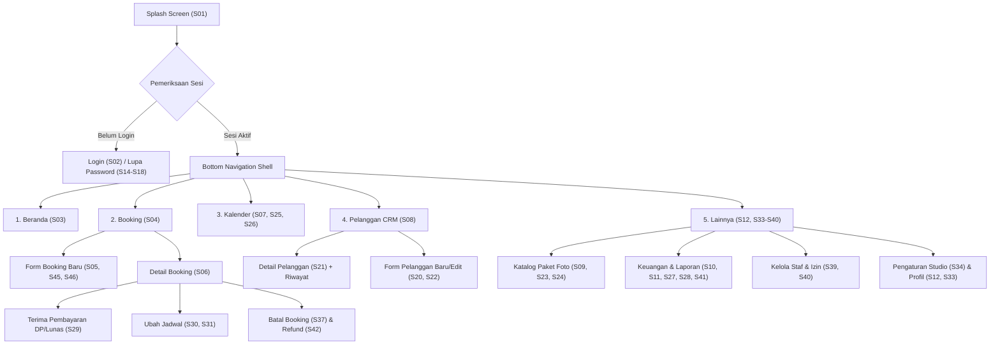

# Rencana Implementasi Bertahap LensFlow

Dokumen ini memetakan seluruh isi desain Figma (~50 layar & state) dan kebutuhan spesifikasi proyek (`LensFlow_Dokumen_Proyek.md`) ke dalam rencana kerja bertahap yang konsisten, aman, dan dapat diverifikasi secara visual maupun fungsional.

## Status implementasi — 26 Oktober 2026

- Tahap 1: autentikasi dan akses studio tetap dipakai.
- Tahap 2: token, skala tipografi, UI kit, format Rupiah/tanggal/waktu, serta lima tab sudah terpasang. Route `/home` kini unik di `(app)/(tabs)/home.tsx`; detail fitur berikutnya dapat diletakkan di Stack `(app)` di luar `(tabs)`.
- Beranda masih fixture lokal berlabel **Pratinjau** sampai Tahap 6. Booking dan Kalender sekarang membaca data studio dari Firestore.
- Tahap 3: pelanggan dan katalog paket membaca/menulis Firestore, lengkap dengan tambah/edit/detail, pencarian awalan, pagination 25 data, normalisasi telepon, peringatan duplikat, status paket, dan pemeriksaan versi. Lihat `Implementasi_Tahap_3.md` serta `../design-qa.md` untuk batas fitur dan hasil uji.
- Tahap 4 telah diimplementasikan: form booking tiga langkah, snapshot, command Functions, pencegahan bentrok atomik, daftar/detail, edit lokasi/catatan, ubah jadwal, pembatalan, selesai sesi, kalender hari/minggu, serta riwayat pelanggan. 23 test aplikasi + 35 integrasi lulus. UI baru belum diuji langsung karena alat browser gagal diinisialisasi; penerimaan visual tetap terbuka. Lihat `Implementasi_Tahap_4.md`.
- Formatter dapat menerima zona lain, tetapi command booking Tahap 4 hanya menerima studio Asia/Jakarta/WIB. Jam default 08.00–21.00, interval 15 menit, tanpa sesi lintas tengah malam. Nomor internasional eksplisit tidak diubah menjadi nomor Indonesia.
- Tipe route dihasilkan oleh Expo CLI saat dev server berjalan; file `.expo/types/router.d.ts` tidak diedit manual dan tidak menggunakan cast `any` untuk navigasi.
- Emulator Firestore memakai `8082`, Auth `9099`, Functions `5001`, dan UI `4000`. Jalankan `npm run backend:install` setelah `npm ci` pada checkout baru.
- Tahap 5 telah diimplementasikan: DP/pelunasan, ledger append-only, pengeluaran/refund owner, saldo, konteks staf pembayaran, filter periode/metode dan ringkasan kas. 28 test aplikasi + 52 integrasi lulus; QA interaksi UI Tahap 4–5 tetap terbuka karena alat browser gagal. Lihat `Implementasi_Tahap_5.md`.
- Tahap 6–9 belum diimplementasikan. Dashboard/notifikasi, laporan analitis dan pengaturan mengikuti urutan di bawah. Penghapusan pelanggan/paket tetap tidak dibuka.

Referensi visual saat ini adalah gambar `Slice 1 (1).png` yang diberikan pengguna. Pemeriksaan mencakup shell Tahap 2 dan alur master data Tahap 3; belum merupakan klaim implementasi 1:1 seluruh layar pada board Figma.

---

## 1. Analisis Desain & Arsitektur Antarmuka (Figma Board)

Berdasarkan analisis visual menyeluruh terhadap board Figma dan inventaris dokumen proyek:

### 1.1 Identitas Visual & Design System (Tokens & UI Kit)
- **Palet Warna Utama**:
  - `Primary Ink`: Hijau tua studio (`#203C35`, `#283A34`) – memberikan kesan premium, profesional, dan menenangkan.
  - `Accent / Brand`: Terakota hangat (`#AF4C2D`, pressed `#933D20`, light `#FCF0E9`) – aksen untuk CTA utama, status penting, dan highlight.
  - `Background & Surface`: Latar krem hangat (`#F8F7F4`), paper putih murni (`#FFFFFF`), border halus (`#E3E7E1`), green light tone (`#EAF0E8`).
  - `Status Colors`:
    - Dikonfirmasi / Selesai / Lunas: Soft Green (`#2E7D32` / `#E8F5E9`)
    - Menunggu DP / Jadwal Dekat: Soft Amber/Yellow (`#ED6C02` / `#FFF4E5`)
    - Batal / Overdue / Error: Muted Red (`#D32F2F` / `#FFEBEE`)
- **Tipografi**:
  - Font Sans-serif sistematis dengan hierarki tegas: Display Heading (34–40px), Section Title (20–24px), Subtitle/Card Title (16–18px), Body/Input (14–15px), Caption/Badge (10–12px uppercase tracking).
- **Komponen Reusable (UI Kit)**:
  - Input field dengan label atas, hint text, state focus & error, toggle mata untuk password, icon prefix/suffix.
  - Button system: Primary (Hijau tua), Secondary/Outline (Border krem/hijau), Destructive (Merah lembut), Ghost button.
  - Status Badges / Chips: Pill rounded, background pastel, text kontras jelas.
  - Cards: Sudut tumpul (*border-radius 16–22px*), border tipis 1px (`#E3E7E1`), spasi konsisten 16–20px.
  - Bottom Tab Navigation: 5 tab (Beranda, Booking, Kalender, Pelanggan, Lainnya) dengan ikon aktif bertinta gelap + dot aksen.

---

### 1.2 Pemetaan Layar & Alur Produk

---

## 2. Status Saat Ini vs Kebutuhan

| Area | Status Saat Ini (Tahap 1 Selesai) | Kebutuhan Target Desain Figma |
|---|---|---|
| **Autentikasi & Akun** | Login email/password, splash native+React, SecureStore, konfirmasi logout | Perlu integrasi forgot-password custom action, profil detail akun |
| **Navigasi Utama** | Hanya single stack route placeholder `(app)/home.tsx` | Perlu Expo Router Bottom Tabs: `Beranda`, `Booking`, `Kalender`, `Pelanggan`, `Lainnya` |
| **Design System** | `tokens.ts` dasar, `AuthField`, `Button`, `Brand` | Perlu komponen Badge, Card, TabBar, SearchBar, FilterChips, Modal Dialog, Stepper, Date/Time Picker |
| **CRM Pelanggan** | Belum ada | Listing, Search, Detail dengan riwayat sesi, Form tambah/edit, Deep-link WA/Call |
| **Katalog Paket** | Belum ada | Listing paket aktif/nonaktif, snapshot harga & durasi, Form tambah/edit paket |
| **Booking & Kalender** | Belum ada | Form booking 3 langkah (Pelanggan, Paket, Waktu), Deteksi bentrok, Kalender (Day/Week/Month), Detail booking |
| **Keuangan & Ledger** | Belum ada | Pencatatan DP, Pelunasan, Pengeluaran, Refund atomik, Laporan omset & grafik |
| **Pengaturan & Staf** | Provisioning admin script | UI kelola staf, toggle 4 hak akses, pengaturan jam studio & default DP |

---

## 3. Rencana Kerja Bertahap (Step-by-Step Roadmap)

Untuk menjaga kualitas kode, kepatuhan arsitektur Expo/React Native, kebersihan typecheck TypeScript, dan kemiripan piksel desain:

### Tahap 2: Pondasi Design System & Shell Navigasi Utama (Tab Bar)
> **Tujuan**: Menghadirkan kerangka navigasi bawah (5 tabs) yang identik dengan Figma, melengkapi token UI kit, dan membuat fondasi komponen umum yang dapat dipakai ulang di semua modul.

- **2.1 Token & Utilities**:
  - Ekspansi `src/theme/tokens.ts` (variasi warna status, border-radius, shadows/elevations, typography scales).
  - Format helper: Rupiah formatter (`Intl.NumberFormat`), format tanggal & jam Indonesia (WIB/studio time).
- **2.2 Komponen Dasar UI Kit**:
  - `Card`: Kontainer standar dengan header, body, footer.
  - `Badge` / `StatusPill`: Komponen status (Confirmed, Pending DP, Paid, Cancelled, Done).
  - `SearchInput` & `FilterChipGroup`: Input pencarian dengan tombol clear dan baris chip horizontal.
  - `HeaderBar`: Header halaman dengan avatar profil, sapaan/judul, dan action icon (notifikasi).
  - `ConfirmationModal`: Modal dialog dengan backdrop blur/gelap untuk konfirmasi aksi penting.
- **2.3 Expo Router Tab Shell**:
  - Stack berada di `src/app/(app)/_layout.tsx`, sedangkan `Tabs` berada di `src/app/(app)/(tabs)/_layout.tsx`.
  - Implementasi Custom Tab Bar sesuai desain (ikon Feather, badge dot, warna ink saat aktif).
  - Daftarkan 5 rute: `home` (Beranda), `bookings`, `calendar`, `clients`, `more`.
- **Hasil Uji**: Lint bersih, Typecheck lulus, tab dapat ditekan dengan transisi halus tanpa flicker.

---

### Tahap 3: Master Data — CRM Pelanggan & Katalog Paket Foto
> **Tujuan**: Membangun entitas fondasi (Pelanggan & Paket) yang menjadi prasyarat pembuatan booking, lengkap dengan validasi dan schema Firestore.

- **3.1 Backend & Firestore Rules**:
  - Collection `studios/{studioId}/clients` (name, nameKey, phone normalized, email, address, notes, leadSource). Jumlah sesi berasal dari modul booking berikutnya, belum disimpan sebagai angka contoh.
  - Collection `studios/{studioId}/packages` (name, price, durationMinutes, editedPhotosCount, isActive, defaultLocation).
  - Rules: owner/CRM mengelola pelanggan; owner mengelola paket; staf booking membaca paket aktif. Query dibatasi, metadata server dan versi wajib, delete ditolak.
- **3.2 Modul CRM Pelanggan (`src/features/master-data/` & `src/app/(app)/clients/`)**:
  - Daftar di `(tabs)/clients.tsx`: avatar inisial, nama, nomor telepon, pencarian awalan yang dibaca dari server, debounce 250 ms, serta pagination 25 data.
  - `[id]/index.tsx`: detail pelanggan, tombol Telepon/WhatsApp via `Linking.openURL`. Riwayat dan hitungan booking menunggu Tahap 4.
  - `new.tsx` / `edit.tsx`: Form input dengan normalisasi nomor WhatsApp Indonesia (`08...` -> `+62...`) dan deteksi duplikat.
  - State kosong (*Empty state*) & error retry.
- **3.3 Modul Paket Foto (`src/features/master-data/` & `src/app/(app)/packages/`)**:
  - Listing paket foto dengan kartu informasi (harga, durasi, jumlah foto editan, status aktif).
  - Form tambah/edit paket foto (hanya dapat diakses owner studio).
- **Hasil Uji**: tambah/baca/edit pelanggan dan paket, status aktif, validasi, duplikat nomor, konflik versi, idempotensi, pagination, isolasi studio, dan izin terverifikasi. 19 test aplikasi + 22 test backend lulus; ekspor Android/iOS/web berhasil. Delete dan riwayat booking tidak termasuk hasil tahap ini. QA visual perangkat fisik serta pencocokan 1:1 tetap Tahap 9.

---

### Tahap 4: Operasional Booking & Kalender (P0 Core)
> **Tujuan**: Menghadirkan alur utama bisnis studio: pembuatan booking baru, pencegahan bentrok jadwal (slot collision), tampilan kalender, dan manajemen status sesi.

- **4.1 Skema & Backend Booking**:
  - Collection `studios/{studioId}/bookings` dengan snapshot data pelanggan & paket (agar perubahan harga katalog di masa depan tidak mengubah histori).
  - Aturan Firestore & Firestore Transaction untuk validasi jadwal overlap secara atomik (mencegah *double booking*).
- **4.2 Form Booking Baru (`src/app/(app)/bookings/new.tsx`)**:
  - Stepper 3 tahap sesuai desain Figma:
    1. *Pilih Pelanggan*: Pilih pelanggan lama dengan pencarian atau shortcut tambah pelanggan baru tanpa keluar alur.
    2. *Pilih Paket Foto*: Pemilihan paket aktif otomatis mengisi estimasi durasi dan perhitungan target DP (30%).
    3. *Jadwal & Rincian*: Pemilih tanggal, jam mulai & jam selesai, lokasi sesi, catatan khusus, dan kalkulasi total biaya.
  - Validasi bentrok jadwal real-time dengan modal peringatan `S31`.
- **4.3 Daftar Booking (`src/app/(app)/(tabs)/bookings.tsx`)**:
  - Filter tab status: *Semua*, *Menunggu DP*, *DP Lunas*, *Lunas*, *Selesai*, *Batal*.
  - Kartu booking dengan tanggal, nama klien, paket, jam sesi, status badge, dan nominal saldo.
- **4.4 Detail Booking (`src/app/(app)/bookings/[id]/index.tsx`)**:
  - Informasi lengkap: Banner status, kartu kontak klien, rincian paket, ringkasan pembayaran (total, terbayar, sisa).
  - Aksi operasional: *Ubah Jadwal (Reschedule)*, *Tandai Selesai*, *Batalkan Booking* (dengan modal konfirmasi).
- **4.5 Tampilan Kalender (`src/app/(app)/(tabs)/calendar.tsx`)**:
  - Toggle view: Tampilan Minggu (*Week*) dan Tampilan Hari (*Day* timeline).
  - Visualisasi slot waktu studio dan penanda sesi foto.
- **Hasil Uji**: Booking tersimpan dengan snapshot akurat, deteksi bentrok terverifikasi, kalender membaca data yang sama dengan list booking.

Status 26 Oktober 2026: kontrak data dan backend/SDK lulus pengujian, ekspor tiga platform berhasil. Pada QA Tahap 6, interaksi mobile web untuk pelanggan baru dari draft booking, simpan, reschedule, batal, pemakaian ulang slot, bentrok dan kalender juga lulus. Kalender 320px tidak overflow horizontal. Kalender memakai agenda per jam/hari dengan pilihan Hari/Minggu. Kecocokan seluruh Figma dan perangkat fisik masih perlu pengujian. Sesi confirmed terpisah dari paymentStatus; pencatatan uang mulai Tahap 5.

---

### Tahap 5: Modul Keuangan & Ledger Transaksi (DP, Pelunasan, Kas Masuk/Keluar)
> **Tujuan**: Memastikan pencatatan kas studio akurat, immutable (append-only ledger), dan mendukung alur pembayaran studio foto (DP -> Pelunasan -> Refund).

- **5.1 Arsitektur Finansial & Firestore Rules**:
  - Collection `studios/{studioId}/transactions` (kind: `income_dp`, `income_settlement`, `refund`, `expense`).
  - Aturan bisnis: Nilai tidak boleh negatif/melebihi sisa tagihan, transaksi uang bersifat *append-only*.
- **5.2 Penerimaan Pembayaran (`Terima Pembayaran`)**:
  - Form Stack dari Detail Booking atau menu Keuangan, dengan konfirmasi setelah uang diverifikasi.
  - Pilihan metode baseline PRD: *Transfer*, *QRIS*. Tunai belum dibuka.
  - Update otomatis sisa tagihan dan status badge booking (`pending_dp` -> `dp_paid` -> `paid`).
- **5.3 Catat Pengeluaran Studio**:
  - Form pencatatan pengeluaran operasional (sewa alat, cetak foto, utilitas, konsumsi).
- **5.4 Pembatalan & Refund**:
  - Alur refund terkontrol oleh owner yang merujuk pada transaksi penerimaan asal.
- **Hasil Uji**: Idempotensi transaksi, saldo booking terhitung tepat, tidak ada uang tercatat ganda.

Status 26 Oktober 2026: command dan repository SDK lulus uji, termasuk race pembayaran/refund, refund per pembayaran asal, versi booking, isolasi studio, immutable ledger, tanggal efektif WIB, dan rekonsiliasi cache kas. Ringkasan kas bulan/metode diperbarui atomik, refund dipisahkan dari pengeluaran. QA Tahap 6 menambahkan uji klik dan screenshot mobile web DP → pelunasan → batal/refund → expense dengan saldo tepat. Perangkat fisik belum diuji. Backdate owner default maksimal 30 hari (konfigurasi Admin `maxFinanceBackdateDays`), staf hanya hari ini; koreksi/reversal posted belum dibuka.

---

### Tahap 6: Beranda Dinamis & Notifikasi Inbox
> **Tujuan**: Menghubungkan layar Beranda (*Dashboard*) dengan data aktual studio dan menyediakan pusat notifikasi pengingat operasional.

- **6.1 Beranda Terintegrasi (`src/app/(app)/home.tsx`)**:
  - Sapaan nama pengguna dan avatar header.
  - KPI Cards: *Sesi Hari Ini* (jumlah sesi aktif), *Kas Masuk Hari Ini* (Rp).
  - Section *Jadwal Terdekat*: Kartu booking terdekat hari ini dengan shortcut ke Detail Booking.
  - Quick Actions: Tombol cepat *+ Booking Baru*, *Tambah Pelanggan*.
- **6.2 Pusat Notifikasi (`src/app/(app)/notifications/index.tsx`)**:
  - Daftar notifikasi operasional: Pengingat pelunasan H-3/H-1, jadwal hari ini, konfirmasi pembayaran masuk.
- **Hasil Uji**: Beranda menampilkan ringkasan tepat sesuai izin pengguna (staf tanpa izin finansial tidak melihat nominal kas).

Status 26 Oktober 2026: Beranda, inbox dan preferensi pribadi selesai pada emulator. Kas masuk bruto dan refund dihitung dari ledger hari WIB; lima sesi terdekat berasal dari data tersimpan. Ringkasan mulai 07.00 dan pengingat H-3/H-1 mulai 09.00 WIB, inbox 30 hari, tanda baca, cursor, deduplikasi dan pemeriksaan ulang izin/data sumber telah diuji. 30 unit + 66 integrasi lulus; uji mobile web end-to-end juga lulus. Worker lokal terverifikasi; scheduler cloud tersedia dalam source tetapi belum dideploy. Push perangkat tidak termasuk. Detail: `docs/Implementasi_Tahap_6.md` dan `design-qa.md`.

---

### Tahap 7: Laporan Keuangan, Grafik Omzet & Analisis Bisnis
> **Tujuan**: Menyediakan visualisasi kesehatan finansial studio foto untuk owner.

- **7.1 Halaman Laporan (`src/app/(app)/reports/index.tsx`)**:
  - Filter periode (Bulan ini, Bulan lalu, Tahun ini, Custom range).
  - Ringkasan Metrik: Total Pemasukan Bruto, Total Refund, Pemasukan Bersih, Pengeluaran, Kas Bersih Studio.
  - Grafik batang native View untuk pemasukan bruto dan kas keluar, dengan rincian angka dan label aksesibilitas.
  - Rincian breakdown transaksi kas masuk & keluar.
- **Hasil Uji**: Rekonsiliasi kas Rp 0 selisih, grafik responsif di berbagai resolusi layar.

Status 26 Oktober 2026: laporan periode bulan ini/lalu, tahun ini dan rentang kustom telah diimplementasikan. Agregasi ledger dan bucket harian/mingguan/bulanan direkonsiliasi dengan kas aktual, termasuk net negatif. Server menegakkan izin reports, batas 366 hari dan 5.000 transaksi. UI diuji pada 390px/320px. Detail: `docs/Implementasi_Tahap_7_8.md`.

---

### Tahap 8: Pengaturan Studio, Kelola Staf & Hak Akses
> **Tujuan**: Melengkapi menu tab "Lainnya" untuk tata kelola studio dan akun.

- **8.1 Menu Tab "Lainnya" (`src/app/(app)/more/index.tsx`)**:
  - Menu list bersih dengan ikon Feather: Profil Saya, Paket Foto, Keuangan & Laporan, Kelola Staf, Pengaturan Studio, Bantuan & FAQ, Tentang LensFlow, Tombol Logout.
- **8.2 Kelola Staf & Otorisasi**:
  - Daftar staf studio dan status keanggotaan (Aktif/Nonaktif).
  - Form undang staf dengan 4 toggle hak akses:
    1. Operasional Booking
    2. Kalender & CRM
    3. Pembayaran & Kas Masuk
    4. Laporan & Keuangan
- **8.3 Pengaturan Studio**:
  - Informasi studio (Nama, Alamat, Nomor Kontak WhatsApp, Jam Operasional, Persentase Default DP).
- **8.4 Profil Pengguna & Edit Akun**:
  - Edit nama, nomor telepon pribadi, dan ganti kata sandi.
- **8.5 Bantuan, FAQ, & Tentang Aplikasi**.

Status 26 Oktober 2026: studio/profil versioned, ganti password dengan autentikasi ulang, daftar/paging staf, empat izin, undangan pending → password Firebase → login/accept, undang ulang dan pencabutan akses telah diimplementasikan. Owner terkunci. Tautan undangan dibagikan manual; email otomatis dan avatar upload belum dibuka. Firebase masih emulator, panduan cloud: `docs/Hubungkan_Firebase.md`.

---

### Tahap 9: Edge States, QA Visual & Polish Aksesibilitas
> **Tujuan**: Pemeriksaan visual komparatif menyeluruh terhadap desain Figma, pengujian ukuran layar ekstrim, dan penanganan kegagalan jaringan.

Status: QA otomatis backend/SDK serta alur mobile web operasional/manajemen sudah dijalankan. Label menu diperjelas untuk aksesibilitas, input/konflik mempertahankan isian dan grafik menampilkan periode terkini. Pemeriksaan seluruh Figma 1:1, seluruh state offline/timeouts/unsaved changes, keyboard/safe area perangkat fisik dan UAT owner/staf tetap terbuka; tahap ini belum dinyatakan selesai penuh atau siap rilis produksi.

- Pemeriksaan 1:1 terhadap Figma (spasi, font-size, line-height, corner radius).
- Verifikasi state: Loading skeletons, Empty states (Booking kosong, Pelanggan kosong), Offline/Network failure retry.
- Uji kompatibilitas layar: Resolusi compact (320px) hingga layar lebar/tablet kecil.
- Eksekusi `npm run lint` dan `npm run typecheck` untuk jaminan zero-error.

---

## 4. Matriks Ringkasan Eksekusi

| Tahap | Modul Utama | Prioritas PRD | Estimasi Kompleksitas |
|---|---|---|---|
| **Tahap 2** | Design System Tokens & Bottom Tabs Shell | P0 | Menengah |
| **Tahap 3** | CRM Pelanggan & Paket Foto | P0 | Menengah |
| **Tahap 4** | Form Booking Stepper, Deteksi Bentrok, & Kalender | P0 | Tinggi |
| **Tahap 5** | Finansial, DP, Pelunasan, & Ledger Kas | P0 | Tinggi |
| **Tahap 6** | Beranda Dinamis & Inbox Notifikasi | P1 | Menengah |
| **Tahap 7** | Laporan Keuangan & Grafik Omzet | P1 | Menengah |
| **Tahap 8** | Tab Lainnya, Kelola Staf (4 Izin), Pengaturan Studio | P1 | Menengah |
| **Tahap 9** | Polish Visual 1:1 Figma & Edge States QA | P0/P1 | Menengah |
